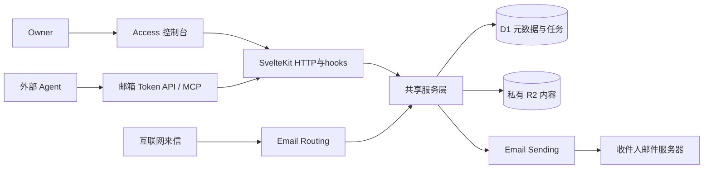

# Agent Mail 个人自部署技术方案

设计基线：2026 年 11 月 13 日。每位使用者将应用部署到自己的 Cloudflare 账户，使用自己的邮件域名、D1、R2 和密钥。一个实例只有一个 Owner，支持多个 Agent 邮箱。发布者维护开源代码，不代管使用者的邮箱或 Cloudflare 凭据。

当前已实现 SvelteKit/单 Worker、D1/R2、收信解析、Owner 控制台、阅读/搜索、草稿/回复、审批发送、MCP 及 OAuth；没有远程部署。实际范围见[开发说明](development.md)、[邮件发送](mail-sending.md)、[MCP 接入](mcp.md)与[OAuth](oauth.md)。本方案替换此前多租户方案，不包含旧 PostgreSQL 数据自动迁移。

配套：[SvelteKit项目结构](project-structure.md)、[数据库字典](database.md)、[API/MCP](api-mcp.md)、[部署与发布](deployment.md)、[验证记录](validation.md)。

## 1 范围与技术选择

首期提供多邮箱、主地址/别名、接收、邮件列表/会话、正文/附件、草稿与人工审批、发送/回复、邮箱级 Token 和 API/MCP。Webhook 是可选功能。外部 Agent 自行运行，不要求使用 Workers AI、不内置必需的 LLM，也不要求平台账号。

采用SvelteKit + TypeScript + 官方adapter-cloudflare部署到单个Workers应用。SvelteKit负责控制台、Owner JSON接口、邮箱API和MCP HTTP；受版本控制的worker/entry.ts把fetch委托给生成的HTTP模块，自己导出email、scheduled及可选queue。两个域名与两份构建/部署配置仍只对应一个Worker。当前版本基线与目录见[项目结构](project-structure.md)，不直接把适配器输出当作完整邮件Worker。

共享业务逻辑位于src/lib/server/core，显式接收env、actor、ctx；路由和原生事件都调用它。HTTP身份在hooks.server.ts中验证，email/scheduled/queue不会经过hooks，须按envelope、持久任务或受信任binding建立各自上下文。数据库、R2、密钥和权限逻辑不得进入浏览器包。第一版不引入Durable Objects、PostgreSQL、Stalwart或第二个服务。

| 组件 | 职责 |
| --- | --- |
| SvelteKit | 控制台页面、Owner API、邮箱Token API/MCP HTTP、请求鉴权 |
| Workers自定义入口 | HTTP委托、email接收、scheduled任务、可选queue，单次部署 |
| D1 | 邮箱、地址、Token 摘要、邮件元数据、对象清单、发送命令、任务、审计 |
| 私有 R2 | 原始 MIME、解析后的大正文、附件、草稿、冻结发送快照及临时导出分片 |
| Email Routing | 将域名来信交给 email handler |
| Email Sending | 默认发送适配器，调用 EMAIL binding |
| Cloudflare Access | 个人控制台和管理入口的人类认证 |
| Cron Triggers | 基础作业领取、重试、对象补账与清理 |
| Queues，可选 | 服务商投递事件、异步唤醒；不是唯一可靠任务来源 |



## 2 单实例与多邮箱

删除用户注册、租户、团队成员、订阅、套餐、支付、商业用量账本和引擎账户映射。一个邮箱是一组本实例拥有的地址和邮件数据，不需要创建 Cloudflare 用户账号。一个邮箱可有多个别名和多个 Token，Token 不可跨邮箱迁移。

推荐专用邮件域名，避免影响既有个人邮箱 MX。首次配置只接受部署者明确允许的邮件域名。平台发行地址采用小写 ASCII local-part，语义校验在业务层执行；外部收件人的 local-part 不机械小写、去点号或移除加号。

地址全局唯一，包含 retired 墓碑；不可删除、转让或重新激活。邮箱删除先撤销 Token 和停用收发，再导出/清理对象与元数据，保留地址墓碑。至少一个有效主地址是激活邮箱的服务事务不变量，不能仅靠部分唯一索引推断“至少一个”。

根域 Catch-all 可以把本域来信统一交给 Worker，再查有效地址目录。未知地址调用受支持的拒绝接口，不自动创建邮箱。根据当前 Wrangler 文档，`addresses` 中的 Catch-all 仅支持 apex；使用收信子域时采用已验证的逐地址路由或明确支持的配置，不把根域示例直接用于子域。[路由文档](https://developers.cloudflare.com/email-service/configuration/email-routing-addresses/)

## 3 Owner 与 Agent 认证

Owner 身份来自部署环境中配置的 OWNER_EMAIL、ACCESS_TEAM_DOMAIN、ACCESS_AUD。Worker 校验 Access JWT 签名、issuer、audience、有效期和明确的 Owner 身份；JWKS 地址来自可信配置，不跟随不可信 token 中的任意 URL。缺配置、过期或验证失败默认拒绝。控制台允许策略只选择本人，不用“第一个访问者成为管理员”。[Access JWT 验证](https://developers.cloudflare.com/cloudflare-one/access-controls/applications/http-apps/authorization-cookie/validating-json/)

控制台和管理API使用console origin，整站Access保护；Agent API/MCP使用api origin，只接受邮箱Token。两个域名绑定同一Worker，wrapper入口保护与SvelteKit hooks共同覆盖请求；不能仅依赖页面layout。assets配置强制run_worker_first，所有私有页面/接口禁止prerender及公共缓存。workers.dev、预览或备用域名不能绕过Owner校验。Owner写操作检查精确Origin并防CSRF，CORS不是认证。[接入细节](project-structure.md)

Token 格式为 `am_<UUID>_<base64url-secret>`，secret 使用 32 随机字节，只有创建时返回。D1 的 secret_sha256 保存完整 Token 的 SHA-256 小写十六进制；高熵随机值不采用低熵密码的设计。服务端以固定长度循环比较摘要，日志不记录完整 Token，禁止 query string 传密钥。一个 Token 的 mailbox_id 非空且不可修改，作用域映射为 DDL 中的布尔列：

| API scope | D1 字段 | 允许 |
| --- | --- | --- |
| mail:read | can_read | 读取当前邮箱的列表、正文、会话 |
| attachments:read | can_read_attachments | 当前邮箱附件；同时需要 can_read |
| mail:draft | can_draft | 创建和编辑草稿 |
| mail:send | can_send | 请求发送；requires_approval 时只创建待批草稿 |

Token 不管理邮箱、签发 Token、修改 Webhook、绕过审批或修改额度。默认只读，默认需要审批；Owner 才能授予直接发送。可随时撤销、到期和轮换。MCP 的 tools/list 隐藏没有权限的工具，tools/call 仍逐次鉴权，不能只在建立连接时校验。

每次请求先验证 Token、到期、撤销和邮箱状态，再从 Token 得到 mailbox_id。所有 SQL 使用该 mailbox_id 的绑定参数；目标资源必须属于该邮箱。D1 没有 RLS，不能让客户端提供邮箱 ID 代替授权。所有对象、附件、草稿、发送、事件关系通过复合外键增加完整性保护，但这不替代运行时权限代码。

## 4 D1 与 R2 数据边界

D1 是 SQLite：ID 使用显式 NOT NULL TEXT 主键，应用生成 UUID；时间使用 UTC Unix 毫秒 INTEGER，布尔为受约束 0/1；结构化小元数据使用 TEXT JSON 与 json_valid。正文、MIME、附件不进入大 JSON 行，避免 D1 行和查询大小限制。[D1 限制](https://developers.cloudflare.com/d1/platform/limits/)

关系数据按 mailbox_id 建索引，邮件/对象等使用 UNIQUE(mailbox_id,id) 与复合外键。可空关系只有真正可缺少的那一列可空；审批 CHECK 显式要求 approved_version 非空，避免 SQLite CHECK 的 NULL 语义绕过约束。

生产 SQL 通过 prepare/bind；多语句写入用 D1 batch。batch 失败会回滚，但条件 UPDATE 影响零行不算 SQL 错误，因此不能假设后续写入自动停止。限额预留使用数据库 trigger：原子更新计数器，未更新一行就 RAISE(ABORT)，让整批回滚；发送命令必须引用实际预留。SQLite 验证脚本覆盖这条失败路径。[D1 batch](https://developers.cloudflare.com/d1/worker-api/d1-database/)、[外键](https://developers.cloudflare.com/d1/sql-api/foreign-keys/)

不使用跨 Worker 调用的 BEGIN/COMMIT、FOR UPDATE、SKIP LOCKED。任务领取采用条件 UPDATE ... RETURNING，写唯一 lease_token；超时回收后旧 Worker 必须匹配租约才能 ACK。第一版不启用读复制；若后续启用，鉴权/撤销检查与写后读取必须使用所需的一致性会话。

R2 桶禁止公共访问。objects 表记录随机 key、mailbox_id、用途、大小、摘要和状态。对象内容一旦持久化不覆盖，编辑生成新对象；数据库冻结已记录的摘要、大小和类型，R2写入同样执行不可覆盖策略。附件读取先查授权记录，再流式读对象；不提供任意 key 下载接口。原始内容、解析派生内容和待发送冻结快照分别标注 purpose。实例删除或导出必须同时考虑 D1 和 R2，D1 恢复点不是完整邮箱备份。

## 5 收信与失败恢复

Email Routing触发同一Worker的email(message,env,ctx)，直接进入worker/handlers/email.ts并调用共享收信服务，不访问SvelteKit路由。使用SMTP envelope recipient匹配active地址与邮箱；To/Cc、Authentication-Results、X-*头不作为授权。输入大小、MIME CPU/内存/嵌套与解压膨胀均有限制。关键持久化必须await，不能只交给waitUntil后提前返回。

处理顺序为：分配 ingest/object UUID → D1 登记 pending_blob 与 pending object → 将原始 MIME 持久化 R2 → D1 batch 标记 ready/stored 并创建 parse_email 作业。只有原文与可恢复工作项都保存后，应用才视为处理成功。解析作业在另一批处理中生成正文、附件和索引；失败保留原文并显示 parse_state，不直接丢弃邮件。

D1 与 R2 没有跨资源事务。Worker 在 R2 写成功但 D1 更新失败时，恢复任务按 object_key 检查对象再继续；pending 缺对象可重试或标记失败；对象清理必须有宽限期并再次确认没有活动引用。不得仅凭对象年龄删除正在上传或等待补账的内容。

Cloudflare 没有在本设计中承诺给每次入站提供可用于去重的稳定 ID。provider_delivery_key 仅在确认来源语义时填写；无可靠 ID 则保持 NULL。Message-ID 和正文摘要都可能重复，不将它们设为唯一投递键。应用自身重试沿用 receipt ID，从而避免重复解析；跨独立投递不承诺完全去重。

Worker 抛错与上游 SMTP 重试的关系必须在真实安装中注入故障验证，不能直接承诺“抛错后 Cloudflare 必然重投”。原文持久化、pending 对账、错误告警和失败可见性是恢复基础。[Email handler](https://developers.cloudflare.com/email-service/api/route-emails/email-handler/)

## 6 草稿与发送

草稿内容放在本邮箱的 R2 对象，D1 记录版本和摘要。审批覆盖 From、Reply-To、全部信封收件人、正文和附件引用；编辑递增版本、清除旧审批。受限 Token 请求发送时生成 awaiting_approval 草稿并返回 202，未批准前不调用 Email Sending、不占用发送额度。

真正提交前重新验证 Token/邮箱/地址状态、scope、审批、收件人规则及附件归属。Owner 手动新建的发送命令可明确使用 Owner 主体，不能悄悄把已撤销 Token 的旧动作升格。From 只能使用本邮箱有效地址，外部 Reply-To 需 Owner 策略允许。

将完整结构化发送请求冻结到 purpose=outbound 的私有 R2 对象：正文、附件引用、To/Cc/Bcc、公开头部和信封语义都进入摘要。该快照不是服务商最终加签的线上 MIME。Bcc 只能作为私有发送参数传给服务商，不进入公开 MIME 头或客户事件。

同一 D1 batch 创建/验证幂等记录、额度预留、outbound_messages、逐收件人和 send_email 作业。每个请求键按 mailbox、已验证主体和操作隔离；相同键不同摘要返回409。SQLite trigger 原子维护 used/reserved；一个命令的 recipient 单位按去重后的真实信封收件人数定义。午夜边界按预留的 UTC 日结算，unknown 不自动退回额度。

SvelteKit 的 `/v1/drafts/{id}/send` 验证后写业务批次并返回202；MCP send_message 返回对应工具结果。发送由 scheduled 消费同一 D1 send_email 作业，MCP 不直接调用提供商。Worker 领取后先写 send_attempts 和 submitting，再调用 env.EMAIL.send。成功保存 provider_message_id 和 accepted 并提交预留；明确拒绝才释放预留。网络超时或未知错误进入 unknown/reconciling，不自动重发；租约过期但已有 started/submitting 也转 unknown。

```text
outbound: queued → submitting → accepted → partial / delivered / bounced / failed
异常: unknown / cancelled
recipient: queued → accepted / deferred → delivered / bounced / failed
reservation: reserved → committed / released / reconciling
```

默认发送接口只提供 messageId，不假定存在服务商级幂等键或按本地 command ID 查询的能力。无法确定结果时保留 unknown，由 Owner 根据服务商记录处理；重发需要明确新命令和审计。单凭自定义 Message-ID、主题或时间接近不能证明同一次发送。[发送接口](https://developers.cloudflare.com/email-service/api/send-emails/workers-api/)

## 7 投递状态与后台任务

基础安装只要求 Worker+D1+R2：成功提交显示 accepted；未开通投递事件时 remote status 为 unknown，不能伪造 delivered。可选 Cloudflare Email Sending Event Subscriptions 经专用 Queue 进入 queue handler，按 provider_message_id 和 recipient 更新，eventId 唯一去重；乱序事件不得把终态降回 deferred，必要时人工核对。

当前事件区分 message.delivered/deferred/bounced/failed/rejected/complained，delivered 是收件服务器接受而非进入收件箱。Routing、verified destination 和部分回复路径不产生这些 Sending 事件，因此未接入时保留 accepted/unknown。队列入口校验专用 Queue 与来源 allowlist，可选自建 HTTP 桥接先验 HMAC，再复用事件校验。[投递事件](https://developers.cloudflare.com/email-service/reference/event-subscriptions/)

明确 hard 退信和投诉建立按邮箱隔离的 D1 抑制名单，发送在入队及提交边界检查完整 To/Cc/Bcc。Owner 查看与解除使用 Access、同源 Origin 和版本更新；Agent 的 mail:send 仅允许检查明确提供的地址，不枚举名单或解除。旧事件不能推翻解除水位，新风险可重新抑制。详见[抑制名单](recipient-suppressions.md)。

Cloudflare 抑制同步/解除的追加式历史经有限批次投影为 D1 告警、变化记录及应用事件，事务水位防止重放重复通知。Owner 确认仅表示知悉；实际成功或确认不存在才解决。已有 HMAC Webhook 负责外部通知与重试；Token/OAuth/MCP 的邮件读取权限不包含运维告警或其投递信息。详见[操作告警](cloudflare-suppression-alerts.md)。

告警 Webhook 的邮箱策略在发布事务中原子记录准入及限频水位，时区静默、开关和恢复配置不改写告警历史。队列领取前及发送前检查当前策略，禁用取消未完成投递；静默暂缓已有任务，迟到响应受租约保护。详见[通知策略](alert-notification-policy.md)。

Owner 决策记录直接查询不可修改的决策与安全事件元数据，固定水位分页和时间窗口统计不推进后台任务。准入/跳过以事件为单位，投递计数以订阅为单位，实时投递汇总和当前页使用同一读取快照；Agent 读取权限不包含这些运维数据。详见[决策记录](alert-notification-decisions.md)。

大量通知决策通过 Owner 异步导出任务处理，0014迁移增加任务及不可变分片清单，完成后共49张表。创建时固定筛选和决策水位，同一 scheduled 入口分批读取、写入私有 R2，并用租约和版本条件提交进度；Webhook 结果按各批次观察时间保存，文件汇总与实际导出的明细一致。Owner 可查看进度、取消及流式下载，下载不暴露 R2 key 或公共 URL，并重新检查状态、邮箱与有效期；创建24小时后过期拒绝下载，后台持续清理分片和迟到写入。同步导出接口保留原语义，详情见[异步导出](async-alert-notification-export.md)。

0015迁移增加导出终态通知和独立限频状态，完成后共51张表。任务第一次成功或最终失败时，D1 触发器在同一事务保存不可变快照；控制台提醒与 Owner 确认独立于外部投递，升级不回填旧终态。scheduled 在既有 Webhook 工作之后处理导出，再每轮投影最多20条终态通知，两个专属事件由后续轮次复用 HMAC、租约、失败退避及投递记录。邮箱总开关、静默和重复间隔共同生效；完成是独立结果，恢复通知开关仅控制抑制故障恢复。导出准入收据不写入原抑制决策表，不改变其统计或导出内容，详情见[完成与失败通知](async-export-notifications.md)。

投递追踪只读联结终态收据、投影事件、冻结投递和尝试记录，按邮箱及通知事件限制分页和详情；无凭据仍可查询，不解密密钥、不写D1、不调用外部服务或R2。Owner手动重试仅重排队已准入且最终失败的投递，要求活动邮箱/端点、当前通知开启且非静默、剩余预算和有效冻结载荷/凭据。操作UUID与版本CAS在同一事务写入审计及重排队；重放只返回原收据，不追加预算。已跳过决定不重新评估，HTTP重试不再消耗重复准入预算，不改变文件有效期。0016仅为既有审计增加资源历史索引，详见[投递追踪与重试](async-export-notification-deliveries.md)。

0017迁移增加批量重试批次与逐项结果，当时共53张表。Owner 在单邮箱内按失败时间（半开窗口，最多31天）及安全原因冻结最多1000条dead候选；10分钟预览与明确确认分离，两次UUID分别防止重复预览和重复提交。每邮箱2个/全实例4个进行中批次，每轮cron最多处理5项，执行时再次校验原版本、通知决定、当前策略、冻结目标/签名和任务租约；24小时截止后不产生新排队。

批量执行复用单条重试的稳定审计收据，保留原事件/投递身份并记录逐项进度；预览后新增失败不加入，预览时不可重试的记录不自动提升权限。未知结果保留待核对状态，只读检查既有审计，不把unknown当成功或盲目重排。既有Webhook传输先运行，批量排队后的实际HTTP由后续cron执行，不增加发送通道、不重评原跳过决定、不延长文件TTL。详见[批量重试](async-export-notification-retry-batches.md)。

Cron触发同一worker/entry.ts的scheduled(controller,env,ctx)，由原生handler读取持久jobs并构造按mailbox受限的system context，直接调用共享服务。它不会经过hooks，也不通过一个公开HTTP定时接口绕行。HTTP/Queues只作低延迟唤醒，任务分批、有限重试和死信；claim/ACK使用条件UPDATE。解析/事件幂等重试，发送遵守unknown规则。可选queue也由同一个Worker导出，验证binding和事件关联后处理，不新增第二个consumer Worker。

## 8 邮件内容与事件安全

HTML 清理危险内容、禁用脚本，默认不加载远程追踪图片。附件默认 unscanned，表示没有做病毒扫描，不能显示为 clean；Token 默认无附件读取权限。Owner 可以显式允许下载未扫描附件并显示状态，blocked 一律禁止；扫描器为可选适配模块，基本部署不虚构 Cloudflare 原生杀毒能力。

邮件正文作为不可信外部数据送给 Agent，不允许其中的指令改变权限、审批或收件人策略。自动回复检查标准自动回复头并限制会话累计动作与频率。日志不记录正文、Token、完整诊断或 Access Cookie。

Webhook endpoint 严格属于一个邮箱，只有 Owner 管理。Owner创建endpoint时应用生成随机签名secret，只展示一次，并用AES-GCM加密后存入signing_secret_ciphertext；封装包含master key ID、随机nonce和密文，JSON元素在服务层验证。Worker secret WEBHOOK_KEYRING保存包装主密钥，应用无需Cloudflare管理Token即可新增endpoint。每个delivery在创建时冻结签名密钥的加密副本与secret版本；endpoint轮换不改变在途delivery使用的版本。签名secret版本与包装主密钥版本分别维护，所有待投递/可重放记录处理完之前保留需要的旧包装密钥。邮箱Token仍只存不可逆摘要，不与Webhook密钥混用。目标仅 HTTPS，阻断内网、loopback、metadata、危险重定向和 DNS rebinding；限制响应体和超时。事件稳定 ID、至少一次投递、退避和死信均持久化。默认 payload 只有资源 ID 和状态，不含正文、附件或其他收件人。

## 9 Cloudflare 条件与成本

使用专用域名并接入 Cloudflare DNS。Email Routing 与向账号已验证地址发送可用于低成本收信验证；向任意收件人发送要求 Workers Paid。Email Sending 当前仍为 Beta，官方限定事务性邮件，不保证适用于所有个人通信场景。读信模式可独立使用，发信适配器保留外部实现接口。[服务范围](https://developers.cloudflare.com/email-service/)、[FAQ](https://developers.cloudflare.com/email-service/reference/faq/)、[价格](https://developers.cloudflare.com/email-service/platform/pricing/)

不宣传完全免费、无限容量或无限发信。Owner 配置上限、私有存储保留期和 Worker CPU 限制，界面展示实际启用的能力。资源费用与凭据留在使用者自己的账户，不引入中心化遥测和必需的远程配置服务器。

## 10 实施阶段

| 阶段 | 验收 |
| --- | --- |
| P0 D1与权限内核 | 本地迁移、Token校验、邮箱固定上下文、复合FK、对象授权、Owner fail closed |
| P1 收信闭环 | 真实域名路由、R2原文、解析索引、故障补账、正文附件控制 |
| P2 发送闭环 | 冻结快照、审批、幂等、原子限额、unknown、真实服务商测试 |
| P3 API/MCP | 同一业务服务、scope一致、兼容客户端测试、跨邮箱拒绝 |
| P4 可部署发布 | Wrangler配置、绑定预配、Access与域名向导、全新账户安装/升级/导出/卸载 |

基础服务、Owner 管理、阅读、发送、MCP 和 OAuth 已本地验收：D1迁移、Token隔离、签名JWT、原生事件、R2、搜索/分页、审批、幂等、防重发，以及 HTML 双正文、CID 和附件发送；OAuth public PKCE 复用同一 Worker。真实域名和 Access 登录、邮件投递仍需云端验收，STDIO 桥接与旧系统导入器另行实现。

0018在原批次表增加不可改写的取消标记。取消和逐项执行通过D1事务及租约/版本围栏串行化，未执行条目停止，已重新排队结果保留。Owner手动对账只验证原稳定审计收据，有证据时恢复结果，无收据时在执行围栏后确认未提交，冲突保持unknown；取消/对账及分页历史复用audit_events。详见[取消与未知结果对账](async-export-notification-retry-controls.md)。

0019在批次结果更新事务内捕获完成、失败和待对账通知快照，共54张表；基于结果转变去重并保留新的未知异常episode。快照和当前批次状态分别展示，Owner确认不改变执行结果。稳定outbox事件通过同一scheduled有界投影，外部通知复用邮箱策略及HMAC传输，限频指纹与原导出/Cloudflare抑制通知隔离。详见[批次完成与异常通知](retry-batch-notifications.md)。

批次通知投递追踪沿用0019快照、事件和Webhook历史表，Owner GET只读查询不解密或推进通知。新的安全重试用稳定audit UUID和原投递版本，在同一D1事务中记录收据与增加有界预算，保留原签名/载荷/目标；真实通知收据优先路由通用重试入口，原跳过决定保持不变。现有0016审计索引足够，无新增DDL。详见[投递追踪](retry-batch-notification-deliveries.md)。

Owner可对批次通知失败投递保存固定预览并幂等确认，后台每轮最多5项处理；0020增加独立两表，当前56表，新任务不生成自身通知或events，避免递归重试。静态Token/OAuth/MCP权限不扩大，详见[通知失败投递批量重试](retry-batch-notification-retry-batches.md)。

通知重试任务的取消和未知结果核对复用0020预留标记、执行租约和audit_events，不增加表或迁移。取消、领取与单条重排准入共享D1版本围栏；已执行结果保留，核对只读取精确原收据且事务冻结证据，不重新排队。新操作不创建事件/通知，详见[通知重试任务控制](retry-batch-notification-retry-controls.md)。
