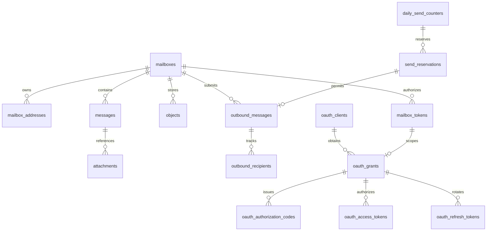

# 个人版 D1 数据库字段与约束

由 migrations/ 中按序迁移在本地SQLite加载后提取，共54张STRICT表；当前迁移为 0001_initial.sql、0002_oauth.sql、0003_setup.sql、0004_attachments.sql、0005_draft_attachments.sql、0006_webhooks.sql、0007_email_delivery_events.sql、0008_recipient_suppressions.sql、0009_cloudflare_suppressions.sql、0010_cloudflare_suppression_history.sql、0011_cloudflare_suppression_alerts.sql、0012_alert_notification_policies.sql、0013_alert_notification_decision_indexes.sql、0014_async_alert_notification_exports.sql、0015_async_export_notifications.sql、0016_export_notification_delivery_history.sql、0017_export_notification_retry_batches.sql、0018_export_notification_retry_controls.sql、0019_retry_batch_notifications.sql。不存在tenant、订阅、PostgreSQL RLS或Stalwart映射。D1仅保存小元数据，原始MIME、正文、附件和冻结快照位于私有R2。业务资源ID为UUID TEXT，OAuth client_id为UUID或HTTPS元数据URL；时间为UTC毫秒INTEGER，布尔为0/1。

一个Token只能绑定一个邮箱。数据库复合外键保障关联完整性，API/MCP仍须逐请求执行邮箱权限。Owner只有一位，由部署配置和Access JWT确定。

## 核心关系



| 表 | 用途 |
| --- | --- |
| alert_notification_decisions | 按事件持久且不可修改的通知允许或降噪决策及策略版本 |
| alert_notification_policies | 按邮箱配置的告警开关、静默时段、限频及恢复通知策略与CAS版本 |
| alert_notification_state | 邮箱与告警限定的最近通知指纹和限频时钟 |
| async_alert_notification_export_chunks | 按邮箱和任务限定的私有R2不可修改分片清单、顺序、字节数和校验和 |
| async_alert_notification_exports | Owner异步导出幂等任务、固定范围与水位、租约进度、24小时有效期和保留清理墓碑 |
| async_export_notification_retry_batches | Owner固定筛选预览、幂等确认、取消围栏与有界批量重试进度和结果历史 |
| async_export_notification_retry_items | 不可变候选投递版本、逐条租约与排队/跳过/失败/未知结果收据 |
| async_export_notification_state | 导出与批次通知按独立命名空间指纹复用的邮箱级Webhook限频时钟 |
| async_export_notifications | 导出终态原子快照、Owner确认、事件投影和独立通知准入收据 |
| async_export_retry_batch_notifications | 批量任务完成/失败/待对账通知不可变快照、Owner确认及Webhook准入收据 |
| attachments | 附件引用与扫描状态 |
| audit_events | Owner、Token与系统操作审计 |
| cloudflare_suppression_alert_cursors | 带升级屏障的执行日志投影游标，避免补发历史告警 |
| cloudflare_suppression_alert_occurrences | 不可修改的告警发生和解决时间线及执行来源 |
| cloudflare_suppression_alerts | Owner失败与未知结果告警、确认版本、重试分组及解决状态 |
| cloudflare_suppression_cache | 账户与发信域限定的Cloudflare抑制完整快照 |
| cloudflare_suppression_history_events | 不可修改的同步/解除/对账状态时间线 |
| cloudflare_suppression_operations | Owner远端解除幂等命令、未知结果及本地CAS联动 |
| cloudflare_suppression_reconciliations | 只读远端对账的幂等执行记录和租约 |
| cloudflare_suppression_sync | 同步与解除共用租约和脱敏同步状态 |
| cloudflare_suppression_sync_runs | Owner与定时同步执行历史、失败原因和重试父记录 |
| daily_send_counters | 按UTC日的个人安全额度 |
| draft_attachment_upload_parts | undefined |
| draft_attachment_uploads | undefined |
| draft_attachments | undefined |
| drafts | 草稿版本与Owner审批 |
| email_delivery_events | Cloudflare投递事件去重、待关联收件箱和安全状态补账 |
| events | 持久应用/服务商事件 |
| idempotency_keys | 邮箱、主体与操作限定的幂等键 |
| ingest_receipts | 收信持久化与解析进度 |
| instance_settings | 单实例配置状态，不存Owner认证秘密 |
| jobs | Cron/可选Queues驱动的持久任务 |
| mailbox_addresses | 主地址、别名与永久墓碑 |
| mailbox_tokens | 严格绑定一个邮箱的可撤销Token |
| mailboxes | 个人拥有的Agent邮箱 |
| message_addresses | 当前邮箱可见的邮件地址 |
| messages | 邮件元数据与内容引用 |
| oauth_access_tokens | 有界访问令牌摘要与scope |
| oauth_authorization_codes | 单次授权码摘要与PKCE绑定 |
| oauth_authorization_requests | Owner同意请求与CSRF摘要 |
| oauth_clients | 公开OAuth客户端登记与CIMD元数据 |
| oauth_grants | 绑定客户端、邮箱Token和resource的授权族 |
| oauth_refresh_tokens | 轮换刷新令牌摘要与同族替换链 |
| oauth_registration_windows | 公开客户端登记的固定窗口计数 |
| objects | 私有R2对象清单与恢复状态 |
| outbound_messages | 冻结发送命令与服务商接受状态 |
| outbound_recipients | 逐收件人投递状态 |
| recipient_suppressions | 按邮箱隔离的永久退信/投诉抑制与Owner解除水位 |
| send_attempts | 服务商提交尝试与unknown |
| send_reservations | trigger维护的额度预留 |
| threads | 邮箱内会话 |
| webhook_deliveries | 稳定事件投递与租约 |
| webhook_delivery_attempts | 有界重试、响应状态与投递租约历史 |
| webhook_endpoints | 按邮箱配置的客户通知目标 |

## 约束与应用职责

地址墓碑、跨邮箱引用、Token绑定、审批版本、租约、原子额度预留与冻结发送字段由DDL约束。Owner JWT、Token secret校验、scope、From有效状态、JSON元素语义、URL/SSRF、附件实际扫描、至少一个主地址和发送unknown处置依赖业务实现，不能以SQLite测试替代。send_reservations与outbound命令及jobs在D1 batch中写入；trigger拒绝超额，避免零行UPDATE后仍创建任务。


## alert_notification_decisions

按事件持久且不可修改的通知允许或降噪决策及策略版本。

| 字段 | 类型 | 非空 | 默认值 | 主键 |
| --- | --- | --- | --- | --- |
| event_id | TEXT | 是 | — | 是 |
| mailbox_id | TEXT | 是 | — | 否 |
| alert_id | TEXT | 是 | — | 否 |
| decision | TEXT | 是 | — | 否 |
| policy_version | INTEGER | 是 | — | 否 |
| decided_at | INTEGER | 是 | — | 否 |
| claim_token | TEXT | 是 | — | 否 |

完整表约束：

```sql
CREATE TABLE alert_notification_decisions (
 event_id TEXT PRIMARY KEY NOT NULL, mailbox_id TEXT NOT NULL, alert_id TEXT NOT NULL,
 decision TEXT NOT NULL CHECK(decision IN('allowed','disabled','quiet_hours','repeat_limited','recovery_disabled','no_subscribers')),
 policy_version INTEGER NOT NULL CHECK(policy_version>=0), decided_at INTEGER NOT NULL CHECK(decided_at>=0),
 claim_token TEXT NOT NULL,
 FOREIGN KEY(mailbox_id,event_id) REFERENCES events(mailbox_id,id)
) STRICT;
```

索引与触发器：

```sql
CREATE INDEX alert_notification_decision_list ON alert_notification_decisions(mailbox_id,decided_at DESC,event_id DESC);
CREATE INDEX alert_notification_decision_reason ON alert_notification_decisions(mailbox_id,decision,decided_at DESC,event_id DESC);
CREATE TRIGGER alert_notification_decision_delete BEFORE DELETE ON alert_notification_decisions BEGIN SELECT RAISE(ABORT,'Alert notification decisions are immutable'); END;
CREATE TRIGGER alert_notification_decision_update BEFORE UPDATE ON alert_notification_decisions BEGIN SELECT RAISE(ABORT,'Alert notification decisions are immutable'); END;
```

## alert_notification_policies

按邮箱配置的告警开关、静默时段、限频及恢复通知策略与CAS版本。

| 字段 | 类型 | 非空 | 默认值 | 主键 |
| --- | --- | --- | --- | --- |
| mailbox_id | TEXT | 是 | — | 是 |
| enabled | INTEGER | 是 | 1 | 否 |
| recovery_enabled | INTEGER | 是 | 1 | 否 |
| repeat_interval_seconds | INTEGER | 是 | 0 | 否 |
| quiet_enabled | INTEGER | 是 | 0 | 否 |
| quiet_start_minute | INTEGER | 是 | 1320 | 否 |
| quiet_end_minute | INTEGER | 是 | 480 | 否 |
| time_zone | TEXT | 是 | 'UTC' | 否 |
| version | INTEGER | 是 | 1 | 否 |
| updated_at | INTEGER | 是 | — | 否 |

完整表约束：

```sql
CREATE TABLE alert_notification_policies (
 mailbox_id TEXT PRIMARY KEY NOT NULL REFERENCES mailboxes(id),
 enabled INTEGER NOT NULL DEFAULT 1 CHECK(enabled IN(0,1)),
 recovery_enabled INTEGER NOT NULL DEFAULT 1 CHECK(recovery_enabled IN(0,1)),
 repeat_interval_seconds INTEGER NOT NULL DEFAULT 0 CHECK(repeat_interval_seconds BETWEEN 0 AND 604800),
 quiet_enabled INTEGER NOT NULL DEFAULT 0 CHECK(quiet_enabled IN(0,1)),
 quiet_start_minute INTEGER NOT NULL DEFAULT 1320 CHECK(quiet_start_minute BETWEEN 0 AND 1439),
 quiet_end_minute INTEGER NOT NULL DEFAULT 480 CHECK(quiet_end_minute BETWEEN 0 AND 1439),
 time_zone TEXT NOT NULL DEFAULT 'UTC' CHECK(length(time_zone) BETWEEN 1 AND 64),
 version INTEGER NOT NULL DEFAULT 1 CHECK(version>0), updated_at INTEGER NOT NULL CHECK(updated_at>=0),
 CHECK(quiet_enabled=0 OR quiet_start_minute<>quiet_end_minute)
) STRICT;
```

索引与触发器：

```sql
CREATE TRIGGER alert_notification_policy_version BEFORE UPDATE ON alert_notification_policies
 WHEN NEW.mailbox_id<>OLD.mailbox_id OR NEW.version<>OLD.version+1 OR NEW.updated_at<=OLD.updated_at
 BEGIN SELECT RAISE(ABORT,'Alert notification policy identity/version is immutable'); END;
```

## alert_notification_state

邮箱与告警限定的最近通知指纹和限频时钟。

| 字段 | 类型 | 非空 | 默认值 | 主键 |
| --- | --- | --- | --- | --- |
| mailbox_id | TEXT | 是 | — | 是 |
| alert_id | TEXT | 是 | — | 是 |
| fingerprint | TEXT | 是 | — | 否 |
| last_notified_at | INTEGER | 否 | — | 否 |

完整表约束：

```sql
CREATE TABLE alert_notification_state (
 mailbox_id TEXT NOT NULL REFERENCES mailboxes(id), alert_id TEXT NOT NULL, fingerprint TEXT NOT NULL,
 last_notified_at INTEGER CHECK(last_notified_at IS NULL OR last_notified_at>=0),
 PRIMARY KEY(mailbox_id,alert_id)
) STRICT;
```

索引与触发器：

```sql
CREATE TRIGGER alert_notification_state_identity BEFORE UPDATE ON alert_notification_state
 WHEN NEW.mailbox_id<>OLD.mailbox_id OR NEW.alert_id<>OLD.alert_id
 BEGIN SELECT RAISE(ABORT,'Alert notification state identity is immutable'); END;
```

## async_alert_notification_export_chunks

按邮箱和任务限定的私有R2不可修改分片清单、顺序、字节数和校验和。

| 字段 | 类型 | 非空 | 默认值 | 主键 |
| --- | --- | --- | --- | --- |
| job_id | TEXT | 是 | — | 是 |
| mailbox_id | TEXT | 是 | — | 否 |
| sequence | INTEGER | 是 | — | 是 |
| object_key | TEXT | 是 | — | 否 |
| size_bytes | INTEGER | 是 | — | 否 |
| sha256 | TEXT | 是 | — | 否 |
| created_at | INTEGER | 是 | — | 否 |

完整表约束：

```sql
CREATE TABLE async_alert_notification_export_chunks (
 job_id TEXT NOT NULL, mailbox_id TEXT NOT NULL, sequence INTEGER NOT NULL CHECK(sequence>0),
 object_key TEXT NOT NULL UNIQUE, size_bytes INTEGER NOT NULL CHECK(size_bytes>0 AND size_bytes<=8388608),
 sha256 TEXT NOT NULL CHECK(length(sha256)=64 AND sha256 NOT GLOB '*[^0-9a-f]*'), created_at INTEGER NOT NULL CHECK(created_at>=0),
 PRIMARY KEY(job_id,sequence), FOREIGN KEY(mailbox_id,job_id) REFERENCES async_alert_notification_exports(mailbox_id,id)
) STRICT;
```

索引与触发器：

```sql
CREATE TRIGGER async_export_chunk_delete BEFORE DELETE ON async_alert_notification_export_chunks BEGIN SELECT RAISE(ABORT,'Async export chunk manifest is retained'); END;
CREATE TRIGGER async_export_chunk_update BEFORE UPDATE ON async_alert_notification_export_chunks BEGIN SELECT RAISE(ABORT,'Async export chunks are immutable'); END;
```

## async_alert_notification_exports

Owner异步导出幂等任务、固定范围与水位、租约进度、24小时有效期和保留清理墓碑。

| 字段 | 类型 | 非空 | 默认值 | 主键 |
| --- | --- | --- | --- | --- |
| id | TEXT | 是 | — | 是 |
| mailbox_id | TEXT | 是 | — | 否 |
| client_request_id | TEXT | 是 | — | 否 |
| request_hash | TEXT | 是 | — | 否 |
| format | TEXT | 是 | — | 否 |
| filter_decision | TEXT | 是 | — | 否 |
| filter_event_type | TEXT | 是 | — | 否 |
| from_ms | INTEGER | 是 | — | 否 |
| to_ms | INTEGER | 是 | — | 否 |
| decision_watermark | INTEGER | 是 | — | 否 |
| total_decisions | INTEGER | 是 | — | 否 |
| processed_decisions | INTEGER | 是 | 0 | 否 |
| processed_deliveries | INTEGER | 是 | 0 | 否 |
| next_time | INTEGER | 否 | — | 否 |
| next_event_id | TEXT | 否 | — | 否 |
| chunk_count | INTEGER | 是 | 0 | 否 |
| body_bytes | INTEGER | 是 | 0 | 否 |
| summary_json | TEXT | 是 | — | 否 |
| state | TEXT | 是 | 'queued' | 否 |
| error_code | TEXT | 否 | — | 否 |
| version | INTEGER | 是 | 1 | 否 |
| created_at | INTEGER | 是 | — | 否 |
| updated_at | INTEGER | 是 | — | 否 |
| started_at | INTEGER | 否 | — | 否 |
| completed_at | INTEGER | 否 | — | 否 |
| expires_at | INTEGER | 是 | — | 否 |
| observed_from | INTEGER | 否 | — | 否 |
| observed_to | INTEGER | 否 | — | 否 |
| lease_token | TEXT | 否 | — | 否 |
| lease_until | INTEGER | 否 | — | 否 |
| attempts | INTEGER | 是 | 0 | 否 |
| failures | INTEGER | 是 | 0 | 否 |
| available_at | INTEGER | 是 | — | 否 |
| cleanup_due_at | INTEGER | 是 | — | 否 |
| last_cleanup_at | INTEGER | 否 | — | 否 |

完整表约束：

```sql
CREATE TABLE async_alert_notification_exports (
 id TEXT PRIMARY KEY NOT NULL, mailbox_id TEXT NOT NULL REFERENCES mailboxes(id),
 client_request_id TEXT NOT NULL, request_hash TEXT NOT NULL CHECK(length(request_hash)=64),
 format TEXT NOT NULL CHECK(format IN('csv','json')),
 filter_decision TEXT NOT NULL CHECK(filter_decision IN('all','allowed','disabled','quiet_hours','repeat_limited','recovery_disabled','no_subscribers')),
 filter_event_type TEXT NOT NULL CHECK(filter_event_type IN('all','created','resolved')),
 from_ms INTEGER NOT NULL CHECK(from_ms>=0), to_ms INTEGER NOT NULL CHECK(to_ms>from_ms AND to_ms-from_ms<=2678400000),
 decision_watermark INTEGER NOT NULL CHECK(decision_watermark>=0),
 total_decisions INTEGER NOT NULL CHECK(total_decisions BETWEEN 0 AND 100000),
 processed_decisions INTEGER NOT NULL DEFAULT 0 CHECK(processed_decisions>=0 AND processed_decisions<=total_decisions),
 processed_deliveries INTEGER NOT NULL DEFAULT 0 CHECK(processed_deliveries BETWEEN 0 AND 1000000),
 next_time INTEGER, next_event_id TEXT, chunk_count INTEGER NOT NULL DEFAULT 0 CHECK(chunk_count>=0),
 body_bytes INTEGER NOT NULL DEFAULT 0 CHECK(body_bytes BETWEEN 0 AND 268435456),
 summary_json TEXT NOT NULL CHECK(json_valid(summary_json) AND json_type(summary_json)='object' AND length(summary_json)<=8192),
 state TEXT NOT NULL DEFAULT 'queued' CHECK(state IN('queued','running','succeeded','failed','cancelled','expired')),
 error_code TEXT CHECK(error_code IS NULL OR length(error_code)<=80),
 version INTEGER NOT NULL DEFAULT 1 CHECK(version>0),
 created_at INTEGER NOT NULL CHECK(created_at>=0), updated_at INTEGER NOT NULL CHECK(updated_at>=created_at),
 started_at INTEGER, completed_at INTEGER, expires_at INTEGER NOT NULL CHECK(expires_at>created_at),
 observed_from INTEGER, observed_to INTEGER,
 lease_token TEXT, lease_until INTEGER, attempts INTEGER NOT NULL DEFAULT 0 CHECK(attempts>=0),
 failures INTEGER NOT NULL DEFAULT 0 CHECK(failures>=0), available_at INTEGER NOT NULL CHECK(available_at>=0),
 cleanup_due_at INTEGER NOT NULL CHECK(cleanup_due_at>=0), last_cleanup_at INTEGER,
 UNIQUE(mailbox_id,id), UNIQUE(mailbox_id,client_request_id),
 CHECK((next_time IS NULL)=(next_event_id IS NULL)), CHECK(next_time IS NULL OR next_time>=0),
 CHECK((observed_from IS NULL)=(observed_to IS NULL)), CHECK(observed_from IS NULL OR observed_to>=observed_from),
 CHECK((state='running' AND lease_token IS NOT NULL AND lease_until IS NOT NULL) OR(state<>'running' AND lease_token IS NULL AND lease_until IS NULL)),
 CHECK(state<>'succeeded' OR processed_decisions=total_decisions)
) STRICT;
```

索引与触发器：

```sql
CREATE INDEX async_export_claim ON async_alert_notification_exports(state,available_at,created_at,id);
CREATE INDEX async_export_cleanup ON async_alert_notification_exports(state,cleanup_due_at,id);
CREATE INDEX async_export_mailbox_list ON async_alert_notification_exports(mailbox_id,created_at DESC,id DESC);
CREATE TRIGGER async_export_identity BEFORE UPDATE ON async_alert_notification_exports
 WHEN NEW.id<>OLD.id OR NEW.mailbox_id<>OLD.mailbox_id OR NEW.client_request_id<>OLD.client_request_id OR NEW.request_hash<>OLD.request_hash
 OR NEW.format<>OLD.format OR NEW.filter_decision<>OLD.filter_decision OR NEW.filter_event_type<>OLD.filter_event_type
 OR NEW.from_ms<>OLD.from_ms OR NEW.to_ms<>OLD.to_ms OR NEW.decision_watermark<>OLD.decision_watermark OR NEW.total_decisions<>OLD.total_decisions
 OR NEW.created_at<>OLD.created_at OR NEW.expires_at<>OLD.expires_at OR NEW.version<>OLD.version+1 OR NEW.updated_at<=OLD.updated_at
 OR NEW.processed_decisions<OLD.processed_decisions OR NEW.processed_deliveries<OLD.processed_deliveries OR NEW.chunk_count<OLD.chunk_count OR NEW.body_bytes<OLD.body_bytes
 OR NEW.attempts<OLD.attempts OR (OLD.started_at IS NOT NULL AND NEW.started_at IS NOT OLD.started_at)
 OR (OLD.observed_from IS NOT NULL AND (NEW.observed_from IS NOT OLD.observed_from OR NEW.observed_to<OLD.observed_to))
 OR (OLD.state='queued' AND NEW.state NOT IN('queued','running','cancelled','expired'))
 OR (OLD.state='running' AND NEW.state NOT IN('running','queued','succeeded','failed','cancelled','expired'))
 OR (OLD.state='succeeded' AND NEW.state NOT IN('succeeded','expired'))
 OR (OLD.state IN('failed','cancelled','expired') AND NEW.state<>OLD.state)
 BEGIN SELECT RAISE(ABORT,'Async export identity/progress is immutable'); END;
CREATE TRIGGER async_export_retained BEFORE DELETE ON async_alert_notification_exports BEGIN SELECT RAISE(ABORT,'Async export cleanup tombstone is retained'); END;
CREATE TRIGGER async_export_terminal_notification AFTER UPDATE OF state ON async_alert_notification_exports
 WHEN OLD.state IN('queued','running') AND NEW.state IN('succeeded','failed')
 BEGIN
  INSERT INTO async_export_notifications(job_id,mailbox_id,outcome,format,total_decisions,processed_decisions,processed_deliveries,body_bytes,
   error_code,completed_at,expires_at,created_at)
  VALUES(NEW.id,NEW.mailbox_id,NEW.state,NEW.format,NEW.total_decisions,NEW.processed_decisions,NEW.processed_deliveries,NEW.body_bytes,
   CASE WHEN NEW.state='succeeded' THEN NULL WHEN NEW.error_code IN('async_export_failed','async_export_storage_unavailable','async_export_limit_exceeded',
    'async_export_batch_too_large','async_export_lease_expired','async_export_checksum_mismatch','async_export_missing_chunk','async_export_expired','async_export_source_changed')
    THEN NEW.error_code ELSE 'async_export_failed' END,COALESCE(NEW.completed_at,NEW.updated_at),NEW.expires_at,COALESCE(NEW.completed_at,NEW.updated_at));
 END;
```

## async_export_notification_retry_batches

Owner固定筛选预览、幂等确认、取消围栏与有界批量重试进度和结果历史。

| 字段 | 类型 | 非空 | 默认值 | 主键 |
| --- | --- | --- | --- | --- |
| id | TEXT | 是 | — | 是 |
| mailbox_id | TEXT | 是 | — | 否 |
| preview_request_id | TEXT | 是 | — | 否 |
| request_hash | TEXT | 是 | — | 否 |
| from_ms | INTEGER | 是 | — | 否 |
| to_ms | INTEGER | 是 | — | 否 |
| filter_reason | TEXT | 是 | — | 否 |
| state | TEXT | 是 | 'preview' | 否 |
| version | INTEGER | 是 | 1 | 否 |
| created_at | INTEGER | 是 | — | 否 |
| updated_at | INTEGER | 是 | — | 否 |
| expires_at | INTEGER | 是 | — | 否 |
| preview_expires_at | INTEGER | 是 | — | 否 |
| commit_request_id | TEXT | 否 | — | 否 |
| commit_expected_version | INTEGER | 否 | — | 否 |
| committed_at | INTEGER | 否 | — | 否 |
| completed_at | INTEGER | 否 | — | 否 |
| total_items | INTEGER | 是 | — | 否 |
| eligible_items | INTEGER | 是 | — | 否 |
| processed_items | INTEGER | 是 | 0 | 否 |
| requeued_items | INTEGER | 是 | 0 | 否 |
| skipped_items | INTEGER | 是 | 0 | 否 |
| failed_items | INTEGER | 是 | 0 | 否 |
| unknown_items | INTEGER | 是 | 0 | 否 |
| cancelled_at | INTEGER | 否 | — | 否 |

完整表约束：

```sql
CREATE TABLE async_export_notification_retry_batches (
 id TEXT PRIMARY KEY NOT NULL,mailbox_id TEXT NOT NULL REFERENCES mailboxes(id),
 preview_request_id TEXT NOT NULL,request_hash TEXT NOT NULL CHECK(length(request_hash)=64),
 from_ms INTEGER NOT NULL CHECK(from_ms>=0),to_ms INTEGER NOT NULL CHECK(to_ms>from_ms AND to_ms-from_ms<=2678400000),
 filter_reason TEXT NOT NULL CHECK(length(filter_reason) BETWEEN 1 AND 80),
 state TEXT NOT NULL DEFAULT 'preview' CHECK(state IN('preview','queued','running','completed','expired')),
 version INTEGER NOT NULL DEFAULT 1 CHECK(version>0),
 created_at INTEGER NOT NULL CHECK(created_at>=0),updated_at INTEGER NOT NULL CHECK(updated_at>=created_at),
 expires_at INTEGER NOT NULL CHECK(expires_at>created_at),preview_expires_at INTEGER NOT NULL CHECK(preview_expires_at>created_at AND preview_expires_at<=expires_at),
 commit_request_id TEXT,commit_expected_version INTEGER CHECK(commit_expected_version IS NULL OR commit_expected_version>0),
 committed_at INTEGER,completed_at INTEGER,
 total_items INTEGER NOT NULL CHECK(total_items BETWEEN 0 AND 1000),eligible_items INTEGER NOT NULL CHECK(eligible_items BETWEEN 0 AND total_items),
 processed_items INTEGER NOT NULL DEFAULT 0 CHECK(processed_items BETWEEN 0 AND total_items),
 requeued_items INTEGER NOT NULL DEFAULT 0 CHECK(requeued_items>=0),skipped_items INTEGER NOT NULL DEFAULT 0 CHECK(skipped_items>=0),
 failed_items INTEGER NOT NULL DEFAULT 0 CHECK(failed_items>=0),unknown_items INTEGER NOT NULL DEFAULT 0 CHECK(unknown_items>=0), cancelled_at INTEGER CHECK(cancelled_at IS NULL OR cancelled_at>=0),
 UNIQUE(mailbox_id,id),UNIQUE(mailbox_id,preview_request_id),UNIQUE(mailbox_id,commit_request_id),
 CHECK(processed_items=requeued_items+skipped_items+failed_items+unknown_items),
 CHECK((commit_request_id IS NULL AND commit_expected_version IS NULL AND committed_at IS NULL)
   OR(commit_request_id IS NOT NULL AND commit_expected_version IS NOT NULL AND committed_at IS NOT NULL)),
 CHECK(state NOT IN('queued','running','completed') OR committed_at IS NOT NULL),
 CHECK(state<>'completed' OR(processed_items=total_items AND unknown_items=0 AND completed_at IS NOT NULL))
) STRICT;
```

索引与触发器：

```sql
CREATE INDEX export_retry_batch_claim ON async_export_notification_retry_batches(state,updated_at,id);
CREATE INDEX export_retry_batch_mailbox ON async_export_notification_retry_batches(mailbox_id,created_at DESC,id DESC);
CREATE TRIGGER export_retry_batch_cancel_immutable
BEFORE UPDATE OF cancelled_at ON async_export_notification_retry_batches
WHEN OLD.cancelled_at IS NOT NULL AND NEW.cancelled_at IS NOT OLD.cancelled_at
BEGIN
  SELECT RAISE(ABORT,'export_retry_batch_cancel_immutable');
END;
CREATE TRIGGER export_retry_batch_identity BEFORE UPDATE ON async_export_notification_retry_batches
 WHEN NEW.id IS NOT OLD.id OR NEW.mailbox_id IS NOT OLD.mailbox_id OR NEW.preview_request_id IS NOT OLD.preview_request_id OR NEW.request_hash IS NOT OLD.request_hash
 OR NEW.from_ms IS NOT OLD.from_ms OR NEW.to_ms IS NOT OLD.to_ms OR NEW.filter_reason IS NOT OLD.filter_reason
 OR NEW.total_items IS NOT OLD.total_items OR NEW.eligible_items IS NOT OLD.eligible_items OR NEW.created_at IS NOT OLD.created_at
 OR NEW.expires_at IS NOT OLD.expires_at OR NEW.preview_expires_at IS NOT OLD.preview_expires_at OR NEW.version<>OLD.version+1 OR NEW.updated_at<=OLD.updated_at
 OR NEW.processed_items<OLD.processed_items
 OR(OLD.commit_request_id IS NOT NULL AND(NEW.commit_request_id IS NOT OLD.commit_request_id OR NEW.commit_expected_version IS NOT OLD.commit_expected_version OR NEW.committed_at IS NOT OLD.committed_at))
 OR(OLD.state='preview' AND NEW.state NOT IN('preview','queued','expired'))
 OR(OLD.state='queued' AND NEW.state NOT IN('queued','running','completed','expired'))
 OR(OLD.state='running' AND NEW.state NOT IN('running','completed','expired'))
 OR(OLD.state='completed' AND NEW.state<>'completed') OR(OLD.state='expired' AND NEW.state<>'expired')
 BEGIN SELECT RAISE(ABORT,'Batch retry identity/selection is immutable'); END;
CREATE TRIGGER export_retry_batch_retained BEFORE DELETE ON async_export_notification_retry_batches
 BEGIN SELECT RAISE(ABORT,'Batch retry history is retained'); END;
CREATE TRIGGER retry_batch_result_notification AFTER UPDATE OF state,failed_items,unknown_items ON async_export_notification_retry_batches
 BEGIN
  INSERT INTO async_export_retry_batch_notifications(mailbox_id,batch_id,kind,reason,source_version,batch_state,total_items,eligible_items,processed_items,requeued_items,skipped_items,failed_items,unknown_items,occurred_at,created_at,endpoint_snapshot_json)
  SELECT NEW.mailbox_id,NEW.id,'completed','completed',NEW.version,'completed',NEW.total_items,NEW.eligible_items,NEW.processed_items,NEW.requeued_items,NEW.skipped_items,NEW.failed_items,NEW.unknown_items,NEW.updated_at,NEW.updated_at,
   (SELECT json_group_array(json_object('id',w.id,'version',w.secret_version,'updatedAt',w.updated_at)) FROM(SELECT id,secret_version,updated_at FROM webhook_endpoints WHERE mailbox_id=NEW.mailbox_id AND status='active' AND EXISTS(SELECT 1 FROM json_each(event_types_json) WHERE value='alert_notification.retry_batch.completed') ORDER BY id LIMIT 10) w)
   WHERE NEW.cancelled_at IS NULL AND NEW.committed_at IS NOT NULL AND OLD.state<>'completed' AND NEW.state='completed';
  INSERT INTO async_export_retry_batch_notifications(mailbox_id,batch_id,kind,reason,source_version,batch_state,total_items,eligible_items,processed_items,requeued_items,skipped_items,failed_items,unknown_items,occurred_at,created_at,endpoint_snapshot_json)
  SELECT NEW.mailbox_id,NEW.id,'failed',CASE WHEN NEW.cancelled_at IS NULL AND NEW.state='expired' AND OLD.state<>'expired' THEN 'expired' ELSE 'execution_failed' END,NEW.version,
   CASE WHEN NEW.cancelled_at IS NOT NULL THEN 'cancelled' ELSE NEW.state END,NEW.total_items,NEW.eligible_items,NEW.processed_items,NEW.requeued_items,NEW.skipped_items,NEW.failed_items,NEW.unknown_items,NEW.updated_at,NEW.updated_at,
   (SELECT json_group_array(json_object('id',w.id,'version',w.secret_version,'updatedAt',w.updated_at)) FROM(SELECT id,secret_version,updated_at FROM webhook_endpoints WHERE mailbox_id=NEW.mailbox_id AND status='active' AND EXISTS(SELECT 1 FROM json_each(event_types_json) WHERE value='alert_notification.retry_batch.failed') ORDER BY id LIMIT 10) w)
   WHERE NEW.committed_at IS NOT NULL AND((OLD.failed_items=0 AND NEW.failed_items>0)
    OR(NEW.cancelled_at IS NULL AND OLD.state<>'expired' AND NEW.state='expired'));
  INSERT INTO async_export_retry_batch_notifications(mailbox_id,batch_id,kind,reason,source_version,batch_state,total_items,eligible_items,processed_items,requeued_items,skipped_items,failed_items,unknown_items,occurred_at,created_at,endpoint_snapshot_json)
  SELECT NEW.mailbox_id,NEW.id,'needs_reconciliation','unknown_results',NEW.version,CASE WHEN NEW.cancelled_at IS NOT NULL THEN 'cancelled' ELSE NEW.state END,
   NEW.total_items,NEW.eligible_items,NEW.processed_items,NEW.requeued_items,NEW.skipped_items,NEW.failed_items,NEW.unknown_items,NEW.updated_at,NEW.updated_at,
   (SELECT json_group_array(json_object('id',w.id,'version',w.secret_version,'updatedAt',w.updated_at)) FROM(SELECT id,secret_version,updated_at FROM webhook_endpoints WHERE mailbox_id=NEW.mailbox_id AND status='active' AND EXISTS(SELECT 1 FROM json_each(event_types_json) WHERE value='alert_notification.retry_batch.needs_reconciliation') ORDER BY id LIMIT 10) w)
   WHERE NEW.committed_at IS NOT NULL AND OLD.unknown_items=0 AND NEW.unknown_items>0;
 END;
```

## async_export_notification_retry_items

不可变候选投递版本、逐条租约与排队/跳过/失败/未知结果收据。

| 字段 | 类型 | 非空 | 默认值 | 主键 |
| --- | --- | --- | --- | --- |
| batch_id | TEXT | 是 | — | 是 |
| mailbox_id | TEXT | 是 | — | 否 |
| delivery_id | TEXT | 是 | — | 是 |
| job_id | TEXT | 是 | — | 否 |
| expected_updated_at | INTEGER | 是 | — | 否 |
| failure_reason | TEXT | 是 | — | 否 |
| failed_at | INTEGER | 是 | — | 否 |
| preview_eligible | INTEGER | 是 | — | 否 |
| preview_reason | TEXT | 否 | — | 否 |
| state | TEXT | 是 | 'pending' | 否 |
| client_request_id | TEXT | 是 | — | 否 |
| reason | TEXT | 否 | — | 否 |
| manual_retry_id | TEXT | 否 | — | 否 |
| created_at | INTEGER | 是 | — | 否 |
| updated_at | INTEGER | 是 | — | 否 |
| completed_at | INTEGER | 否 | — | 否 |
| lease_token | TEXT | 否 | — | 否 |
| lease_until | INTEGER | 否 | — | 否 |
| version | INTEGER | 是 | 1 | 否 |

完整表约束：

```sql
CREATE TABLE async_export_notification_retry_items (
 batch_id TEXT NOT NULL,mailbox_id TEXT NOT NULL,delivery_id TEXT NOT NULL,job_id TEXT NOT NULL,
 expected_updated_at INTEGER NOT NULL CHECK(expected_updated_at>=0),failure_reason TEXT NOT NULL CHECK(length(failure_reason) BETWEEN 1 AND 80),failed_at INTEGER NOT NULL CHECK(failed_at>=0),
 preview_eligible INTEGER NOT NULL CHECK(preview_eligible IN(0,1)),preview_reason TEXT CHECK(preview_reason IS NULL OR length(preview_reason)<=80),
 state TEXT NOT NULL DEFAULT 'pending' CHECK(state IN('pending','running','requeued','skipped','failed','unknown')),
 client_request_id TEXT NOT NULL UNIQUE,reason TEXT CHECK(reason IS NULL OR length(reason)<=80),manual_retry_id TEXT REFERENCES audit_events(id),
 created_at INTEGER NOT NULL CHECK(created_at>=0),updated_at INTEGER NOT NULL CHECK(updated_at>=created_at),completed_at INTEGER,
 lease_token TEXT,lease_until INTEGER,version INTEGER NOT NULL DEFAULT 1 CHECK(version>0),
 PRIMARY KEY(batch_id,delivery_id),
 FOREIGN KEY(mailbox_id,batch_id) REFERENCES async_export_notification_retry_batches(mailbox_id,id),
 FOREIGN KEY(mailbox_id,delivery_id) REFERENCES webhook_deliveries(mailbox_id,id),
 FOREIGN KEY(mailbox_id,job_id) REFERENCES async_alert_notification_exports(mailbox_id,id),
 CHECK((preview_eligible=1 AND preview_reason IS NULL) OR(preview_eligible=0 AND preview_reason IS NOT NULL)),
 CHECK((state='running' AND lease_token IS NOT NULL AND lease_until IS NOT NULL) OR(state<>'running' AND lease_token IS NULL AND lease_until IS NULL)),
 CHECK(state NOT IN('requeued','skipped','failed','unknown') OR completed_at IS NOT NULL)
) STRICT;
```

索引与触发器：

```sql
CREATE INDEX export_retry_item_batch ON async_export_notification_retry_items(batch_id,delivery_id);
CREATE INDEX export_retry_item_claim ON async_export_notification_retry_items(state,updated_at,batch_id,delivery_id);
CREATE TRIGGER export_retry_item_identity BEFORE UPDATE ON async_export_notification_retry_items
 WHEN NEW.batch_id IS NOT OLD.batch_id OR NEW.mailbox_id IS NOT OLD.mailbox_id OR NEW.delivery_id IS NOT OLD.delivery_id OR NEW.job_id IS NOT OLD.job_id
 OR NEW.expected_updated_at IS NOT OLD.expected_updated_at OR NEW.failure_reason IS NOT OLD.failure_reason OR NEW.failed_at IS NOT OLD.failed_at
 OR NEW.preview_eligible IS NOT OLD.preview_eligible OR NEW.preview_reason IS NOT OLD.preview_reason OR NEW.client_request_id IS NOT OLD.client_request_id OR NEW.created_at IS NOT OLD.created_at
 OR NEW.version<>OLD.version+1 OR NEW.updated_at<=OLD.updated_at
 OR(OLD.manual_retry_id IS NOT NULL AND NEW.manual_retry_id IS NOT OLD.manual_retry_id)
 OR(OLD.state IN('requeued','skipped','failed') AND NEW.state<>OLD.state)
 OR(OLD.state='unknown' AND NEW.state NOT IN('unknown','requeued','skipped','failed'))
 OR(OLD.state='running' AND NEW.state='pending')
 BEGIN SELECT RAISE(ABORT,'Batch retry item selection/result is immutable'); END;
CREATE TRIGGER export_retry_item_retained BEFORE DELETE ON async_export_notification_retry_items
 BEGIN SELECT RAISE(ABORT,'Batch retry item history is retained'); END;
```

## async_export_notification_state

导出与批次通知按独立命名空间指纹复用的邮箱级Webhook限频时钟。

| 字段 | 类型 | 非空 | 默认值 | 主键 |
| --- | --- | --- | --- | --- |
| mailbox_id | TEXT | 是 | — | 是 |
| fingerprint | TEXT | 是 | — | 是 |
| last_notified_at | INTEGER | 是 | — | 否 |

完整表约束：

```sql
CREATE TABLE async_export_notification_state (
 mailbox_id TEXT NOT NULL REFERENCES mailboxes(id), fingerprint TEXT NOT NULL CHECK(length(fingerprint) BETWEEN 1 AND 1024),
 last_notified_at INTEGER NOT NULL CHECK(last_notified_at>=0), PRIMARY KEY(mailbox_id,fingerprint)
) STRICT;
```

索引与触发器：

```sql
CREATE TRIGGER async_export_notification_state_identity BEFORE UPDATE ON async_export_notification_state
 WHEN NEW.mailbox_id IS NOT OLD.mailbox_id OR NEW.fingerprint IS NOT OLD.fingerprint OR NEW.last_notified_at<OLD.last_notified_at
 BEGIN SELECT RAISE(ABORT,'Async export notification state identity is immutable'); END;
```

## async_export_notifications

导出终态原子快照、Owner确认、事件投影和独立通知准入收据。

| 字段 | 类型 | 非空 | 默认值 | 主键 |
| --- | --- | --- | --- | --- |
| job_id | TEXT | 是 | — | 是 |
| mailbox_id | TEXT | 是 | — | 否 |
| outcome | TEXT | 是 | — | 否 |
| format | TEXT | 是 | — | 否 |
| total_decisions | INTEGER | 是 | — | 否 |
| processed_decisions | INTEGER | 是 | — | 否 |
| processed_deliveries | INTEGER | 是 | — | 否 |
| body_bytes | INTEGER | 是 | — | 否 |
| error_code | TEXT | 否 | — | 否 |
| completed_at | INTEGER | 是 | — | 否 |
| expires_at | INTEGER | 是 | — | 否 |
| created_at | INTEGER | 是 | — | 否 |
| acknowledged_at | INTEGER | 否 | — | 否 |
| version | INTEGER | 是 | 1 | 否 |
| event_id | TEXT | 否 | — | 否 |
| projected_at | INTEGER | 否 | — | 否 |
| notification_decision | TEXT | 否 | — | 否 |
| policy_version | INTEGER | 否 | — | 否 |
| decided_at | INTEGER | 否 | — | 否 |
| claim_token | TEXT | 否 | — | 否 |

完整表约束：

```sql
CREATE TABLE async_export_notifications (
 job_id TEXT PRIMARY KEY NOT NULL, mailbox_id TEXT NOT NULL,
 outcome TEXT NOT NULL CHECK(outcome IN('succeeded','failed')),
 format TEXT NOT NULL CHECK(format IN('csv','json')),
 total_decisions INTEGER NOT NULL CHECK(total_decisions BETWEEN 0 AND 100000),
 processed_decisions INTEGER NOT NULL CHECK(processed_decisions BETWEEN 0 AND total_decisions),
 processed_deliveries INTEGER NOT NULL CHECK(processed_deliveries BETWEEN 0 AND 1000000),
 body_bytes INTEGER NOT NULL CHECK(body_bytes BETWEEN 0 AND 268435456),
 error_code TEXT CHECK(error_code IS NULL OR error_code IN('async_export_failed','async_export_storage_unavailable','async_export_limit_exceeded',
  'async_export_batch_too_large','async_export_lease_expired','async_export_checksum_mismatch','async_export_missing_chunk','async_export_expired','async_export_source_changed')),
 completed_at INTEGER NOT NULL CHECK(completed_at>=0), expires_at INTEGER NOT NULL CHECK(expires_at>=0),
 created_at INTEGER NOT NULL CHECK(created_at>=0), acknowledged_at INTEGER CHECK(acknowledged_at IS NULL OR acknowledged_at>=created_at),
 version INTEGER NOT NULL DEFAULT 1 CHECK(version>0),
 event_id TEXT UNIQUE, projected_at INTEGER CHECK(projected_at IS NULL OR projected_at>=created_at),
 notification_decision TEXT CHECK(notification_decision IS NULL OR notification_decision IN('allowed','disabled','quiet_hours','repeat_limited','no_subscribers')),
 policy_version INTEGER CHECK(policy_version IS NULL OR policy_version>=0),
 decided_at INTEGER CHECK(decided_at IS NULL OR decided_at>=0), claim_token TEXT,
 FOREIGN KEY(mailbox_id,job_id) REFERENCES async_alert_notification_exports(mailbox_id,id),
 FOREIGN KEY(mailbox_id,event_id) REFERENCES events(mailbox_id,id),
 CHECK((event_id IS NULL)=(projected_at IS NULL)),
 CHECK((notification_decision IS NULL AND policy_version IS NULL AND decided_at IS NULL AND claim_token IS NULL)
  OR(notification_decision IS NOT NULL AND policy_version IS NOT NULL AND decided_at IS NOT NULL AND claim_token IS NOT NULL AND length(claim_token)>0)),
 CHECK(notification_decision IS NULL OR event_id IS NOT NULL),
 CHECK(outcome<>'succeeded' OR(processed_decisions=total_decisions AND error_code IS NULL))
) STRICT;
```

索引与触发器：

```sql
CREATE INDEX async_export_notifications_mailbox ON async_export_notifications(mailbox_id,created_at DESC,job_id DESC);
CREATE INDEX async_export_notifications_project ON async_export_notifications(projected_at,created_at,job_id);
CREATE INDEX async_export_notifications_unread ON async_export_notifications(mailbox_id,acknowledged_at,created_at DESC,job_id DESC);
CREATE TRIGGER async_export_notification_identity BEFORE UPDATE ON async_export_notifications
 WHEN NEW.job_id IS NOT OLD.job_id OR NEW.mailbox_id IS NOT OLD.mailbox_id OR NEW.outcome IS NOT OLD.outcome OR NEW.format IS NOT OLD.format
 OR NEW.total_decisions IS NOT OLD.total_decisions OR NEW.processed_decisions IS NOT OLD.processed_decisions
 OR NEW.processed_deliveries IS NOT OLD.processed_deliveries OR NEW.body_bytes IS NOT OLD.body_bytes OR NEW.error_code IS NOT OLD.error_code
 OR NEW.completed_at IS NOT OLD.completed_at OR NEW.expires_at IS NOT OLD.expires_at OR NEW.created_at IS NOT OLD.created_at
 OR NOT((NEW.acknowledged_at IS OLD.acknowledged_at AND NEW.version=OLD.version)
   OR(OLD.acknowledged_at IS NULL AND NEW.acknowledged_at IS NOT NULL AND NEW.version=OLD.version+1))
 OR(OLD.event_id IS NOT NULL AND(NEW.event_id IS NOT OLD.event_id OR NEW.projected_at IS NOT OLD.projected_at))
 OR(OLD.notification_decision IS NOT NULL AND(NEW.notification_decision IS NOT OLD.notification_decision OR NEW.policy_version IS NOT OLD.policy_version
   OR NEW.decided_at IS NOT OLD.decided_at OR NEW.claim_token IS NOT OLD.claim_token))
 BEGIN SELECT RAISE(ABORT,'Async export notification facts/receipts are immutable'); END;
CREATE TRIGGER async_export_notification_retained BEFORE DELETE ON async_export_notifications
 BEGIN SELECT RAISE(ABORT,'Async export notification is retained'); END;
```

## async_export_retry_batch_notifications

批量任务完成/失败/待对账通知不可变快照、Owner确认及Webhook准入收据。

| 字段 | 类型 | 非空 | 默认值 | 主键 |
| --- | --- | --- | --- | --- |
| id | TEXT | 是 | lower(hex(randomblob(4)))\|\|'-'\|\|lower(hex(randomblob(2)))\|\|'-4'\|\|substr(lower(hex(randomblob(2))),2)\|\|'-'\|\|substr('89ab',(random()&3)+1,1)\|\|substr(lower(hex(randomblob(2))),2)\|\|'-'\|\|lower(hex(randomblob(6))) | 是 |
| mailbox_id | TEXT | 是 | — | 否 |
| batch_id | TEXT | 是 | — | 否 |
| kind | TEXT | 是 | — | 否 |
| reason | TEXT | 是 | — | 否 |
| source_version | INTEGER | 是 | — | 否 |
| endpoint_snapshot_json | TEXT | 是 | '[]' | 否 |
| batch_state | TEXT | 是 | — | 否 |
| total_items | INTEGER | 是 | — | 否 |
| eligible_items | INTEGER | 是 | — | 否 |
| processed_items | INTEGER | 是 | — | 否 |
| requeued_items | INTEGER | 是 | — | 否 |
| skipped_items | INTEGER | 是 | — | 否 |
| failed_items | INTEGER | 是 | — | 否 |
| unknown_items | INTEGER | 是 | — | 否 |
| occurred_at | INTEGER | 是 | — | 否 |
| created_at | INTEGER | 是 | — | 否 |
| acknowledged_at | INTEGER | 否 | — | 否 |
| version | INTEGER | 是 | 1 | 否 |
| event_id | TEXT | 否 | — | 否 |
| projected_at | INTEGER | 否 | — | 否 |
| notification_decision | TEXT | 否 | — | 否 |
| policy_version | INTEGER | 否 | — | 否 |
| decided_at | INTEGER | 否 | — | 否 |
| claim_token | TEXT | 否 | — | 否 |

完整表约束：

```sql
CREATE TABLE async_export_retry_batch_notifications (
 id TEXT PRIMARY KEY NOT NULL DEFAULT(lower(hex(randomblob(4)))||'-'||lower(hex(randomblob(2)))||'-4'||substr(lower(hex(randomblob(2))),2)||'-'||substr('89ab',(random()&3)+1,1)||substr(lower(hex(randomblob(2))),2)||'-'||lower(hex(randomblob(6)))),
 mailbox_id TEXT NOT NULL,batch_id TEXT NOT NULL,
 kind TEXT NOT NULL CHECK(kind IN('completed','failed','needs_reconciliation')),
 reason TEXT NOT NULL CHECK(reason IN('completed','execution_failed','expired','unknown_results')),
 source_version INTEGER NOT NULL CHECK(source_version>0),
 endpoint_snapshot_json TEXT NOT NULL DEFAULT '[]' CHECK(json_valid(endpoint_snapshot_json) AND json_type(endpoint_snapshot_json)='array' AND json_array_length(endpoint_snapshot_json)<=10),
 batch_state TEXT NOT NULL CHECK(batch_state IN('preview','queued','running','completed','expired','cancelled')),
 total_items INTEGER NOT NULL CHECK(total_items BETWEEN 0 AND 1000),eligible_items INTEGER NOT NULL CHECK(eligible_items BETWEEN 0 AND total_items),
 processed_items INTEGER NOT NULL CHECK(processed_items BETWEEN 0 AND total_items),
 requeued_items INTEGER NOT NULL CHECK(requeued_items>=0),skipped_items INTEGER NOT NULL CHECK(skipped_items>=0),
 failed_items INTEGER NOT NULL CHECK(failed_items>=0),unknown_items INTEGER NOT NULL CHECK(unknown_items>=0),
 occurred_at INTEGER NOT NULL CHECK(occurred_at>=0),created_at INTEGER NOT NULL CHECK(created_at>=occurred_at),
 acknowledged_at INTEGER CHECK(acknowledged_at IS NULL OR acknowledged_at>=created_at),version INTEGER NOT NULL DEFAULT 1 CHECK(version>0),
 event_id TEXT UNIQUE,projected_at INTEGER CHECK(projected_at IS NULL OR projected_at>=created_at),
 notification_decision TEXT CHECK(notification_decision IS NULL OR notification_decision IN('allowed','disabled','quiet_hours','repeat_limited','no_subscribers')),
 policy_version INTEGER CHECK(policy_version IS NULL OR policy_version>=0),decided_at INTEGER CHECK(decided_at IS NULL OR decided_at>=0),claim_token TEXT,
 FOREIGN KEY(mailbox_id,batch_id) REFERENCES async_export_notification_retry_batches(mailbox_id,id),
 FOREIGN KEY(mailbox_id,event_id) REFERENCES events(mailbox_id,id),
 UNIQUE(batch_id,kind,source_version),
 CHECK(processed_items=requeued_items+skipped_items+failed_items+unknown_items),
 CHECK((kind='completed' AND reason='completed' AND batch_state='completed' AND processed_items=total_items AND unknown_items=0)
   OR(kind='failed' AND reason='execution_failed' AND failed_items>0)
   OR(kind='failed' AND reason='expired' AND batch_state='expired')
   OR(kind='needs_reconciliation' AND reason='unknown_results' AND unknown_items>0)),
 CHECK((event_id IS NULL)=(projected_at IS NULL)),
 CHECK((notification_decision IS NULL AND policy_version IS NULL AND decided_at IS NULL AND claim_token IS NULL)
   OR(notification_decision IS NOT NULL AND policy_version IS NOT NULL AND decided_at IS NOT NULL AND claim_token IS NOT NULL AND length(claim_token)>0)),
 CHECK(notification_decision IS NULL OR event_id IS NOT NULL)
) STRICT;
```

索引与触发器：

```sql
CREATE INDEX retry_batch_notifications_mailbox ON async_export_retry_batch_notifications(mailbox_id,created_at DESC,id DESC);
CREATE INDEX retry_batch_notifications_project ON async_export_retry_batch_notifications(projected_at,created_at,id);
CREATE INDEX retry_batch_notifications_unread ON async_export_retry_batch_notifications(mailbox_id,acknowledged_at,created_at DESC,id DESC);
CREATE TRIGGER retry_batch_notification_identity BEFORE UPDATE ON async_export_retry_batch_notifications
 WHEN NEW.id IS NOT OLD.id OR NEW.mailbox_id IS NOT OLD.mailbox_id OR NEW.batch_id IS NOT OLD.batch_id
 OR NEW.kind IS NOT OLD.kind OR NEW.reason IS NOT OLD.reason OR NEW.source_version IS NOT OLD.source_version OR NEW.batch_state IS NOT OLD.batch_state OR NEW.endpoint_snapshot_json IS NOT OLD.endpoint_snapshot_json
 OR NEW.total_items IS NOT OLD.total_items OR NEW.eligible_items IS NOT OLD.eligible_items OR NEW.processed_items IS NOT OLD.processed_items
 OR NEW.requeued_items IS NOT OLD.requeued_items OR NEW.skipped_items IS NOT OLD.skipped_items OR NEW.failed_items IS NOT OLD.failed_items OR NEW.unknown_items IS NOT OLD.unknown_items
 OR NEW.occurred_at IS NOT OLD.occurred_at OR NEW.created_at IS NOT OLD.created_at
 OR NOT((NEW.acknowledged_at IS OLD.acknowledged_at AND NEW.version=OLD.version)
   OR(OLD.acknowledged_at IS NULL AND NEW.acknowledged_at IS NOT NULL AND NEW.version=OLD.version+1))
 OR(OLD.event_id IS NOT NULL AND(NEW.event_id IS NOT OLD.event_id OR NEW.projected_at IS NOT OLD.projected_at))
 OR(OLD.notification_decision IS NOT NULL AND(NEW.notification_decision IS NOT OLD.notification_decision OR NEW.policy_version IS NOT OLD.policy_version
   OR NEW.decided_at IS NOT OLD.decided_at OR NEW.claim_token IS NOT OLD.claim_token))
 BEGIN SELECT RAISE(ABORT,'Retry batch notification facts/receipts are immutable'); END;
CREATE TRIGGER retry_batch_notification_retained BEFORE DELETE ON async_export_retry_batch_notifications
 BEGIN SELECT RAISE(ABORT,'Retry batch notification history is retained'); END;
```

## attachments

附件引用与扫描状态。

| 字段 | 类型 | 非空 | 默认值 | 主键 |
| --- | --- | --- | --- | --- |
| id | TEXT | 是 | — | 是 |
| mailbox_id | TEXT | 是 | — | 否 |
| message_id | TEXT | 是 | — | 否 |
| object_id | TEXT | 是 | — | 否 |
| part_id | TEXT | 是 | — | 否 |
| filename | TEXT | 否 | — | 否 |
| disposition | TEXT | 是 | 'attachment' | 否 |
| content_id | TEXT | 否 | — | 否 |
| scan_status | TEXT | 是 | 'unscanned' | 否 |

完整表约束：

```sql
CREATE TABLE attachments (
 id TEXT NOT NULL PRIMARY KEY, mailbox_id TEXT NOT NULL, message_id TEXT NOT NULL, object_id TEXT NOT NULL,
 part_id TEXT NOT NULL, filename TEXT,
 disposition TEXT NOT NULL DEFAULT 'attachment' CHECK(disposition IN('attachment','inline')), content_id TEXT,
 scan_status TEXT NOT NULL DEFAULT 'unscanned' CHECK(scan_status IN('unscanned','clean','blocked','failed')),
 UNIQUE(mailbox_id,id), UNIQUE(message_id,part_id),
 FOREIGN KEY(mailbox_id,message_id) REFERENCES messages(mailbox_id,id),
 FOREIGN KEY(mailbox_id,object_id) REFERENCES objects(mailbox_id,id)
) STRICT;
```

索引与触发器：

```sql
CREATE INDEX attachments_message ON attachments(mailbox_id,message_id,part_id);
```

## audit_events

Owner、Token与系统操作审计。

| 字段 | 类型 | 非空 | 默认值 | 主键 |
| --- | --- | --- | --- | --- |
| id | TEXT | 是 | — | 是 |
| mailbox_id | TEXT | 否 | — | 否 |
| actor_kind | TEXT | 是 | — | 否 |
| token_id | TEXT | 否 | — | 否 |
| action | TEXT | 是 | — | 否 |
| resource_id | TEXT | 否 | — | 否 |
| outcome | TEXT | 是 | — | 否 |
| request_id | TEXT | 是 | — | 否 |
| metadata_json | TEXT | 是 | '{}' | 否 |
| occurred_at | INTEGER | 是 | — | 否 |

完整表约束：

```sql
CREATE TABLE audit_events (
 id TEXT NOT NULL PRIMARY KEY, mailbox_id TEXT REFERENCES mailboxes(id),
 actor_kind TEXT NOT NULL CHECK(actor_kind IN('owner','token','system')), token_id TEXT,
 action TEXT NOT NULL, resource_id TEXT, outcome TEXT NOT NULL CHECK(outcome IN('success','denied','failure')),
 request_id TEXT NOT NULL, metadata_json TEXT NOT NULL DEFAULT '{}' CHECK(json_valid(metadata_json) AND json_type(metadata_json)='object'),
 occurred_at INTEGER NOT NULL CHECK(occurred_at>=0),
 FOREIGN KEY(mailbox_id,token_id) REFERENCES mailbox_tokens(mailbox_id,id),
 CHECK((actor_kind='token' AND token_id IS NOT NULL AND mailbox_id IS NOT NULL) OR(actor_kind<>'token' AND token_id IS NULL))
) STRICT;
```

索引与触发器：

```sql
CREATE INDEX audit_list ON audit_events(mailbox_id,occurred_at DESC,id DESC);
CREATE INDEX audit_resource_history ON audit_events(mailbox_id,resource_id,action,occurred_at DESC,id DESC);
```

## cloudflare_suppression_alert_cursors

带升级屏障的执行日志投影游标，避免补发历史告警。

| 字段 | 类型 | 非空 | 默认值 | 主键 |
| --- | --- | --- | --- | --- |
| account_id | TEXT | 是 | — | 是 |
| domain | TEXT | 是 | — | 是 |
| last_rowid | INTEGER | 是 | — | 否 |

完整表约束：

```sql
CREATE TABLE cloudflare_suppression_alert_cursors (
 account_id TEXT NOT NULL, domain TEXT NOT NULL, last_rowid INTEGER NOT NULL CHECK(last_rowid>=0),
 PRIMARY KEY(account_id,domain), CHECK((account_id='')=(domain=''))
) STRICT;
```

## cloudflare_suppression_alert_occurrences

不可修改的告警发生和解决时间线及执行来源。

| 字段 | 类型 | 非空 | 默认值 | 主键 |
| --- | --- | --- | --- | --- |
| id | TEXT | 是 | — | 是 |
| alert_id | TEXT | 是 | — | 否 |
| journal_id | TEXT | 是 | — | 否 |
| action | TEXT | 是 | — | 否 |
| outcome | TEXT | 是 | — | 否 |
| version | INTEGER | 是 | — | 否 |
| error_code | TEXT | 否 | — | 否 |
| occurred_at | INTEGER | 是 | — | 否 |
| source_id | TEXT | 是 | — | 否 |

完整表约束：

```sql
CREATE TABLE cloudflare_suppression_alert_occurrences (
 id TEXT PRIMARY KEY NOT NULL, alert_id TEXT NOT NULL REFERENCES cloudflare_suppression_alerts(id),
 journal_id TEXT NOT NULL REFERENCES cloudflare_suppression_history_events(id),
 action TEXT NOT NULL CHECK(action IN('failed','resolved')), outcome TEXT NOT NULL CHECK(outcome IN('failed','unknown','resolved')),
 version INTEGER NOT NULL, error_code TEXT, occurred_at INTEGER NOT NULL, source_id TEXT NOT NULL,
 UNIQUE(alert_id,journal_id)
) STRICT;
```

索引与触发器：

```sql
CREATE INDEX cloudflare_suppression_alert_timeline ON cloudflare_suppression_alert_occurrences(alert_id,version DESC);
CREATE TRIGGER cloudflare_suppression_alert_occurrence_delete BEFORE DELETE ON cloudflare_suppression_alert_occurrences BEGIN SELECT RAISE(ABORT,'Alert timeline is append only'); END;
CREATE TRIGGER cloudflare_suppression_alert_occurrence_update BEFORE UPDATE ON cloudflare_suppression_alert_occurrences BEGIN SELECT RAISE(ABORT,'Alert timeline is append only'); END;
```

## cloudflare_suppression_alerts

Owner失败与未知结果告警、确认版本、重试分组及解决状态。

| 字段 | 类型 | 非空 | 默认值 | 主键 |
| --- | --- | --- | --- | --- |
| id | TEXT | 是 | — | 是 |
| account_id | TEXT | 是 | — | 否 |
| domain | TEXT | 是 | — | 否 |
| kind | TEXT | 是 | — | 否 |
| group_key | TEXT | 是 | — | 否 |
| mailbox_id | TEXT | 否 | — | 否 |
| global_scope | INTEGER | 是 | — | 否 |
| status | TEXT | 是 | — | 否 |
| outcome | TEXT | 是 | — | 否 |
| version | INTEGER | 是 | — | 否 |
| generation | INTEGER | 是 | — | 否 |
| occurrences | INTEGER | 是 | — | 否 |
| error_code | TEXT | 否 | — | 否 |
| first_occurred_at | INTEGER | 是 | — | 否 |
| last_occurred_at | INTEGER | 是 | — | 否 |
| acknowledged_at | INTEGER | 否 | — | 否 |
| resolved_at | INTEGER | 否 | — | 否 |
| source_id | TEXT | 是 | — | 否 |
| last_fingerprint | TEXT | 是 | — | 否 |
| last_journal_id | TEXT | 是 | — | 否 |

完整表约束：

```sql
CREATE TABLE cloudflare_suppression_alerts (
 id TEXT PRIMARY KEY NOT NULL, account_id TEXT NOT NULL, domain TEXT NOT NULL,
 kind TEXT NOT NULL CHECK(kind IN('sync','release')), group_key TEXT NOT NULL,
 mailbox_id TEXT REFERENCES mailboxes(id), global_scope INTEGER NOT NULL CHECK(global_scope IN(0,1)),
 status TEXT NOT NULL CHECK(status IN('open','acknowledged','resolved')),
 outcome TEXT NOT NULL CHECK(outcome IN('failed','unknown','resolved')),
 version INTEGER NOT NULL CHECK(version>0), generation INTEGER NOT NULL CHECK(generation>0), occurrences INTEGER NOT NULL CHECK(occurrences>0),
 error_code TEXT, first_occurred_at INTEGER NOT NULL, last_occurred_at INTEGER NOT NULL,
 acknowledged_at INTEGER, resolved_at INTEGER, source_id TEXT NOT NULL,
 last_fingerprint TEXT NOT NULL, last_journal_id TEXT NOT NULL REFERENCES cloudflare_suppression_history_events(id),
 UNIQUE(account_id,domain,kind,group_key),
 CHECK((global_scope=1 AND mailbox_id IS NULL AND kind='sync') OR(global_scope=0 AND mailbox_id IS NOT NULL)),
 CHECK((status='resolved')=(outcome='resolved'))
) STRICT;
```

索引与触发器：

```sql
CREATE INDEX cloudflare_suppression_alert_list ON cloudflare_suppression_alerts(account_id,domain,last_occurred_at DESC,id DESC);
CREATE TRIGGER cloudflare_suppression_alert_identity BEFORE UPDATE ON cloudflare_suppression_alerts
 WHEN NEW.id<>OLD.id OR NEW.account_id<>OLD.account_id OR NEW.domain<>OLD.domain OR NEW.kind<>OLD.kind OR NEW.group_key<>OLD.group_key
 OR NEW.mailbox_id IS NOT OLD.mailbox_id OR NEW.global_scope<>OLD.global_scope OR NEW.first_occurred_at<>OLD.first_occurred_at
 OR NEW.version<>OLD.version+1 OR NEW.generation<OLD.generation OR NEW.occurrences<OLD.occurrences
 BEGIN SELECT RAISE(ABORT,'Suppression alert identity/version is immutable'); END;
```

## cloudflare_suppression_cache

账户与发信域限定的Cloudflare抑制完整快照。

| 字段 | 类型 | 非空 | 默认值 | 主键 |
| --- | --- | --- | --- | --- |
| account_id | TEXT | 是 | — | 是 |
| configured_domain | TEXT | 是 | — | 是 |
| remote_id | TEXT | 是 | — | 是 |
| address | TEXT | 是 | — | 否 |
| scope_type | TEXT | 是 | — | 否 |
| scope_value | TEXT | 是 | — | 否 |
| reason | TEXT | 是 | — | 否 |
| read_only | INTEGER | 是 | — | 否 |
| status | TEXT | 是 | 'active' | 否 |
| version_hash | TEXT | 是 | — | 否 |
| expires_at | INTEGER | 否 | — | 否 |
| provider_created_at | INTEGER | 是 | — | 否 |
| seen_at | INTEGER | 是 | — | 否 |
| updated_at | INTEGER | 是 | — | 否 |
| last_sync_id | TEXT | 是 | — | 否 |

完整表约束：

```sql
CREATE TABLE cloudflare_suppression_cache (
 account_id TEXT NOT NULL, configured_domain TEXT NOT NULL, remote_id TEXT NOT NULL,
 address TEXT NOT NULL, scope_type TEXT NOT NULL CHECK(scope_type IN('account','sending_domain')), scope_value TEXT NOT NULL,
 reason TEXT NOT NULL CHECK(reason IN('manual','complaint','hard_bounce','soft_bounce','policy')), read_only INTEGER NOT NULL CHECK(read_only IN(0,1)),
 status TEXT NOT NULL DEFAULT 'active' CHECK(status IN('active','absent')), version_hash TEXT NOT NULL CHECK(length(version_hash)=64),
 expires_at INTEGER CHECK(expires_at IS NULL OR expires_at>=0), provider_created_at INTEGER NOT NULL CHECK(provider_created_at>=0),
 seen_at INTEGER NOT NULL CHECK(seen_at>=0), updated_at INTEGER NOT NULL CHECK(updated_at>=0), last_sync_id TEXT NOT NULL,
 PRIMARY KEY(account_id,configured_domain,remote_id),
 CHECK((scope_type='account' AND scope_value='') OR(scope_type='sending_domain' AND scope_value=configured_domain))
) STRICT;
```

索引与触发器：

```sql
CREATE INDEX cloudflare_suppression_lookup ON cloudflare_suppression_cache(account_id,configured_domain,status,address);
```

## cloudflare_suppression_history_events

不可修改的同步/解除/对账状态时间线。

| 字段 | 类型 | 非空 | 默认值 | 主键 |
| --- | --- | --- | --- | --- |
| id | TEXT | 是 | — | 是 |
| account_id | TEXT | 是 | — | 否 |
| domain | TEXT | 是 | — | 否 |
| kind | TEXT | 是 | — | 否 |
| resource_id | TEXT | 是 | — | 否 |
| action | TEXT | 是 | — | 否 |
| state | TEXT | 是 | — | 否 |
| remote_status | TEXT | 否 | — | 否 |
| local_status | TEXT | 否 | — | 否 |
| error_code | TEXT | 否 | — | 否 |
| count | INTEGER | 否 | — | 否 |
| occurred_at | INTEGER | 是 | — | 否 |

完整表约束：

```sql
CREATE TABLE cloudflare_suppression_history_events (
 id TEXT PRIMARY KEY NOT NULL, account_id TEXT NOT NULL, domain TEXT NOT NULL, kind TEXT NOT NULL CHECK(kind IN('sync','release')),
 resource_id TEXT NOT NULL, action TEXT NOT NULL, state TEXT NOT NULL, remote_status TEXT, local_status TEXT,
 error_code TEXT, count INTEGER, occurred_at INTEGER NOT NULL
) STRICT;
```

索引与触发器：

```sql
CREATE INDEX cloudflare_suppression_history_timeline ON cloudflare_suppression_history_events(account_id,domain,kind,resource_id,occurred_at DESC,id DESC);
CREATE TRIGGER cloudflare_suppression_history_immutable_delete BEFORE DELETE ON cloudflare_suppression_history_events BEGIN SELECT RAISE(ABORT,'Suppression journal is append only'); END;
CREATE TRIGGER cloudflare_suppression_history_immutable_update BEFORE UPDATE ON cloudflare_suppression_history_events BEGIN SELECT RAISE(ABORT,'Suppression journal is append only'); END;
```

## cloudflare_suppression_operations

Owner远端解除幂等命令、未知结果及本地CAS联动。

| 字段 | 类型 | 非空 | 默认值 | 主键 |
| --- | --- | --- | --- | --- |
| id | TEXT | 是 | — | 是 |
| request_hash | TEXT | 是 | — | 否 |
| account_id | TEXT | 是 | — | 否 |
| domain | TEXT | 是 | — | 否 |
| mailbox_id | TEXT | 是 | — | 否 |
| remote_id | TEXT | 是 | — | 否 |
| address | TEXT | 是 | — | 否 |
| scope_type | TEXT | 是 | — | 否 |
| scope_value | TEXT | 是 | — | 否 |
| version_hash | TEXT | 是 | — | 否 |
| release_local | INTEGER | 是 | — | 否 |
| local_id | TEXT | 否 | — | 否 |
| local_version | INTEGER | 否 | — | 否 |
| state | TEXT | 是 | — | 否 |
| remote_status | TEXT | 是 | — | 否 |
| local_status | TEXT | 是 | — | 否 |
| lease_token | TEXT | 否 | — | 否 |
| lease_until | INTEGER | 否 | — | 否 |
| created_at | INTEGER | 是 | — | 否 |
| updated_at | INTEGER | 是 | — | 否 |
| completed_at | INTEGER | 否 | — | 否 |
| error_code | TEXT | 否 | — | 否 |
| retry_of | TEXT | 否 | — | 否 |
| verified_at | INTEGER | 否 | — | 否 |
| verified_read_only | INTEGER | 否 | — | 否 |
| verified_version | TEXT | 否 | — | 否 |

完整表约束：

```sql
CREATE TABLE cloudflare_suppression_operations (
 id TEXT NOT NULL PRIMARY KEY, request_hash TEXT NOT NULL CHECK(length(request_hash)=64),
 account_id TEXT NOT NULL, domain TEXT NOT NULL, mailbox_id TEXT NOT NULL REFERENCES mailboxes(id), remote_id TEXT NOT NULL,
 address TEXT NOT NULL, scope_type TEXT NOT NULL CHECK(scope_type IN('account','sending_domain')), scope_value TEXT NOT NULL,
 version_hash TEXT NOT NULL CHECK(length(version_hash)=64),
 release_local INTEGER NOT NULL CHECK(release_local IN(0,1)), local_id TEXT, local_version INTEGER,
 state TEXT NOT NULL CHECK(state IN('preparing','deleting','succeeded','failed','unknown','confirmed_absent')),
 remote_status TEXT NOT NULL CHECK(remote_status IN('in_progress','deleted','already_absent','unknown','failed')),
 local_status TEXT NOT NULL CHECK(local_status IN('not_requested','released','changed','pending')),
 lease_token TEXT, lease_until INTEGER, created_at INTEGER NOT NULL, updated_at INTEGER NOT NULL, completed_at INTEGER, error_code TEXT, retry_of TEXT REFERENCES cloudflare_suppression_operations(id), verified_at INTEGER, verified_read_only INTEGER CHECK(verified_read_only IN(0,1)), verified_version TEXT,
 CHECK((lease_token IS NULL)=(lease_until IS NULL)),
 CHECK((release_local=0 AND local_id IS NULL AND local_version IS NULL) OR(release_local=1 AND local_id IS NOT NULL AND local_version>0)),
 FOREIGN KEY(mailbox_id,local_id) REFERENCES recipient_suppressions(mailbox_id,id)
) STRICT;
```

索引与触发器：

```sql
CREATE UNIQUE INDEX cloudflare_suppression_open_operation ON cloudflare_suppression_operations(account_id,domain,remote_id)
 WHERE state IN('preparing','deleting','unknown');
CREATE INDEX cloudflare_suppression_operation_list ON cloudflare_suppression_operations(account_id,domain,mailbox_id,created_at DESC,id DESC);
CREATE UNIQUE INDEX cloudflare_suppression_operation_scope ON cloudflare_suppression_operations(account_id,domain,mailbox_id,id);
CREATE TRIGGER cloudflare_suppression_operation_created AFTER INSERT ON cloudflare_suppression_operations BEGIN
 INSERT INTO cloudflare_suppression_history_events VALUES(lower(hex(randomblob(16))),NEW.account_id,NEW.domain,'release',NEW.id,'release.started',NEW.state,NEW.remote_status,NEW.local_status,NEW.error_code,NULL,NEW.created_at);
END;
CREATE TRIGGER cloudflare_suppression_operation_identity BEFORE UPDATE ON cloudflare_suppression_operations
 WHEN NEW.id<>OLD.id OR NEW.request_hash<>OLD.request_hash OR NEW.account_id<>OLD.account_id OR NEW.domain<>OLD.domain
 OR NEW.mailbox_id<>OLD.mailbox_id OR NEW.remote_id<>OLD.remote_id OR NEW.address<>OLD.address OR NEW.scope_type<>OLD.scope_type
 OR NEW.scope_value<>OLD.scope_value OR NEW.version_hash<>OLD.version_hash OR NEW.release_local<>OLD.release_local
 OR NEW.local_id IS NOT OLD.local_id OR NEW.local_version IS NOT OLD.local_version OR NEW.created_at<>OLD.created_at OR NEW.updated_at<OLD.updated_at
 BEGIN SELECT RAISE(ABORT,'Cloudflare suppression operation identity is immutable'); END;
CREATE TRIGGER cloudflare_suppression_operation_transition AFTER UPDATE ON cloudflare_suppression_operations
 WHEN NEW.state<>OLD.state OR NEW.remote_status<>OLD.remote_status OR NEW.local_status<>OLD.local_status OR NEW.error_code IS NOT OLD.error_code OR NEW.verified_at IS NOT OLD.verified_at BEGIN
 INSERT INTO cloudflare_suppression_history_events VALUES(lower(hex(randomblob(16))),NEW.account_id,NEW.domain,'release',NEW.id,'release.updated',NEW.state,NEW.remote_status,NEW.local_status,NEW.error_code,NULL,NEW.updated_at);
END;
CREATE TRIGGER cloudflare_suppression_retry_identity BEFORE UPDATE ON cloudflare_suppression_operations
 WHEN NEW.retry_of IS NOT OLD.retry_of BEGIN SELECT RAISE(ABORT,'Suppression retry lineage is immutable'); END;
```

## cloudflare_suppression_reconciliations

只读远端对账的幂等执行记录和租约。

| 字段 | 类型 | 非空 | 默认值 | 主键 |
| --- | --- | --- | --- | --- |
| id | TEXT | 是 | — | 是 |
| request_hash | TEXT | 是 | — | 否 |
| operation_id | TEXT | 是 | — | 否 |
| account_id | TEXT | 是 | — | 否 |
| domain | TEXT | 是 | — | 否 |
| mailbox_id | TEXT | 是 | — | 否 |
| state | TEXT | 是 | — | 否 |
| error_code | TEXT | 否 | — | 否 |
| started_at | INTEGER | 是 | — | 否 |
| completed_at | INTEGER | 否 | — | 否 |
| lease_token | TEXT | 否 | — | 否 |
| lease_until | INTEGER | 否 | — | 否 |

完整表约束：

```sql
CREATE TABLE cloudflare_suppression_reconciliations (
 id TEXT PRIMARY KEY NOT NULL, request_hash TEXT NOT NULL, operation_id TEXT NOT NULL REFERENCES cloudflare_suppression_operations(id),
 account_id TEXT NOT NULL, domain TEXT NOT NULL, mailbox_id TEXT NOT NULL REFERENCES mailboxes(id),
 state TEXT NOT NULL CHECK(state IN('running','succeeded','failed')), error_code TEXT,
 started_at INTEGER NOT NULL, completed_at INTEGER, lease_token TEXT, lease_until INTEGER,
 CHECK((lease_token IS NULL)=(lease_until IS NULL)),
 FOREIGN KEY(account_id,domain,mailbox_id,operation_id) REFERENCES cloudflare_suppression_operations(account_id,domain,mailbox_id,id)
) STRICT;
```

索引与触发器：

```sql
CREATE TRIGGER cloudflare_suppression_reconcile_completed AFTER UPDATE ON cloudflare_suppression_reconciliations BEGIN
 INSERT INTO cloudflare_suppression_history_events SELECT lower(hex(randomblob(16))),NEW.account_id,NEW.domain,'release',NEW.operation_id,'reconcile.completed',state,remote_status,local_status,NEW.error_code,NULL,NEW.completed_at FROM cloudflare_suppression_operations WHERE id=NEW.operation_id;
END;
CREATE TRIGGER cloudflare_suppression_reconcile_identity BEFORE UPDATE ON cloudflare_suppression_reconciliations
 WHEN NEW.id<>OLD.id OR NEW.request_hash<>OLD.request_hash OR NEW.operation_id<>OLD.operation_id OR NEW.account_id<>OLD.account_id
 OR NEW.domain<>OLD.domain OR NEW.mailbox_id<>OLD.mailbox_id OR NEW.started_at<>OLD.started_at OR OLD.state<>'running'
 BEGIN SELECT RAISE(ABORT,'Suppression reconciliation history is immutable'); END;
CREATE TRIGGER cloudflare_suppression_reconcile_started AFTER INSERT ON cloudflare_suppression_reconciliations BEGIN
 INSERT INTO cloudflare_suppression_history_events SELECT lower(hex(randomblob(16))),NEW.account_id,NEW.domain,'release',NEW.operation_id,'reconcile.started',state,remote_status,local_status,NULL,NULL,NEW.started_at FROM cloudflare_suppression_operations WHERE id=NEW.operation_id;
END;
```

## cloudflare_suppression_sync

同步与解除共用租约和脱敏同步状态。

| 字段 | 类型 | 非空 | 默认值 | 主键 |
| --- | --- | --- | --- | --- |
| account_id | TEXT | 是 | — | 是 |
| domain | TEXT | 是 | — | 是 |
| lease_token | TEXT | 否 | — | 否 |
| lease_until | INTEGER | 否 | — | 否 |
| last_attempt_at | INTEGER | 否 | — | 否 |
| last_success_at | INTEGER | 否 | — | 否 |
| last_error_code | TEXT | 否 | — | 否 |

完整表约束：

```sql
CREATE TABLE cloudflare_suppression_sync (
 account_id TEXT NOT NULL, domain TEXT NOT NULL, lease_token TEXT, lease_until INTEGER,
 last_attempt_at INTEGER, last_success_at INTEGER, last_error_code TEXT,
 PRIMARY KEY(account_id,domain), CHECK((lease_token IS NULL)=(lease_until IS NULL))
) STRICT;
```

## cloudflare_suppression_sync_runs

Owner与定时同步执行历史、失败原因和重试父记录。

| 字段 | 类型 | 非空 | 默认值 | 主键 |
| --- | --- | --- | --- | --- |
| id | TEXT | 是 | — | 是 |
| request_hash | TEXT | 是 | — | 否 |
| account_id | TEXT | 是 | — | 否 |
| domain | TEXT | 是 | — | 否 |
| mailbox_id | TEXT | 否 | — | 否 |
| source | TEXT | 是 | — | 否 |
| retry_of | TEXT | 否 | — | 否 |
| state | TEXT | 是 | — | 否 |
| count | INTEGER | 否 | — | 否 |
| error_code | TEXT | 否 | — | 否 |
| started_at | INTEGER | 是 | — | 否 |
| completed_at | INTEGER | 否 | — | 否 |
| lease_token | TEXT | 否 | — | 否 |
| lease_until | INTEGER | 否 | — | 否 |

完整表约束：

```sql
CREATE TABLE cloudflare_suppression_sync_runs (
 id TEXT PRIMARY KEY NOT NULL, request_hash TEXT NOT NULL, account_id TEXT NOT NULL, domain TEXT NOT NULL,
 mailbox_id TEXT REFERENCES mailboxes(id), source TEXT NOT NULL CHECK(source IN('owner','scheduled')),
 retry_of TEXT REFERENCES cloudflare_suppression_sync_runs(id),
 state TEXT NOT NULL CHECK(state IN('running','succeeded','failed')), count INTEGER,
 error_code TEXT, started_at INTEGER NOT NULL, completed_at INTEGER, lease_token TEXT, lease_until INTEGER,
 CHECK((lease_token IS NULL)=(lease_until IS NULL)),
 FOREIGN KEY(account_id,domain,retry_of) REFERENCES cloudflare_suppression_sync_runs(account_id,domain,id)
) STRICT;
```

索引与触发器：

```sql
CREATE UNIQUE INDEX cloudflare_suppression_run_scope ON cloudflare_suppression_sync_runs(account_id,domain,id);
CREATE INDEX cloudflare_suppression_sync_runs_list ON cloudflare_suppression_sync_runs(account_id,domain,started_at DESC,id DESC);
CREATE TRIGGER cloudflare_suppression_run_identity BEFORE UPDATE ON cloudflare_suppression_sync_runs
 WHEN NEW.id<>OLD.id OR NEW.request_hash<>OLD.request_hash OR NEW.account_id<>OLD.account_id OR NEW.domain<>OLD.domain
 OR NEW.mailbox_id IS NOT OLD.mailbox_id OR NEW.source<>OLD.source OR NEW.retry_of IS NOT OLD.retry_of OR NEW.started_at<>OLD.started_at
 OR OLD.state<>'running' BEGIN SELECT RAISE(ABORT,'Suppression sync history is immutable'); END;
CREATE TRIGGER cloudflare_suppression_sync_completed AFTER UPDATE ON cloudflare_suppression_sync_runs BEGIN
 INSERT INTO cloudflare_suppression_history_events VALUES(lower(hex(randomblob(16))),NEW.account_id,NEW.domain,'sync',NEW.id,'sync.completed',NEW.state,NULL,NULL,NEW.error_code,NEW.count,COALESCE(NEW.completed_at,NEW.started_at));
END;
CREATE TRIGGER cloudflare_suppression_sync_started AFTER INSERT ON cloudflare_suppression_sync_runs BEGIN
 INSERT INTO cloudflare_suppression_history_events VALUES(lower(hex(randomblob(16))),NEW.account_id,NEW.domain,'sync',NEW.id,'sync.started',NEW.state,NULL,NULL,NEW.error_code,NEW.count,NEW.started_at);
END;
```

## daily_send_counters

按UTC日的个人安全额度。

| 字段 | 类型 | 非空 | 默认值 | 主键 |
| --- | --- | --- | --- | --- |
| id | TEXT | 是 | — | 是 |
| mailbox_id | TEXT | 是 | — | 否 |
| day_utc | TEXT | 是 | — | 否 |
| limit_snapshot | INTEGER | 是 | — | 否 |
| reserved_units | INTEGER | 是 | 0 | 否 |
| used_units | INTEGER | 是 | 0 | 否 |

完整表约束：

```sql
CREATE TABLE daily_send_counters (
 id TEXT NOT NULL PRIMARY KEY, mailbox_id TEXT NOT NULL REFERENCES mailboxes(id),
 day_utc TEXT NOT NULL CHECK(length(day_utc)=10 AND day_utc GLOB '[0-9][0-9][0-9][0-9]-[0-9][0-9]-[0-9][0-9]'),
 limit_snapshot INTEGER NOT NULL CHECK(limit_snapshot>=0),
 reserved_units INTEGER NOT NULL DEFAULT 0 CHECK(reserved_units>=0), used_units INTEGER NOT NULL DEFAULT 0 CHECK(used_units>=0),
 UNIQUE(mailbox_id,id), UNIQUE(mailbox_id,day_utc)
) STRICT;
```

## draft_attachment_upload_parts

undefined。

| 字段 | 类型 | 非空 | 默认值 | 主键 |
| --- | --- | --- | --- | --- |
| upload_id | TEXT | 是 | — | 是 |
| mailbox_id | TEXT | 是 | — | 否 |
| offset_bytes | INTEGER | 是 | — | 是 |
| size_bytes | INTEGER | 是 | — | 否 |
| object_key | TEXT | 是 | — | 否 |
| sha256 | TEXT | 是 | — | 否 |
| created_at | INTEGER | 是 | — | 否 |

完整表约束：

```sql
CREATE TABLE draft_attachment_upload_parts (
 upload_id TEXT NOT NULL, mailbox_id TEXT NOT NULL, offset_bytes INTEGER NOT NULL CHECK(offset_bytes>=0),
 size_bytes INTEGER NOT NULL CHECK(size_bytes>0 AND size_bytes<=65536), object_key TEXT NOT NULL UNIQUE,
 sha256 TEXT NOT NULL CHECK(length(sha256)=64 AND sha256 NOT GLOB '*[^0-9a-f]*'), created_at INTEGER NOT NULL CHECK(created_at>=0),
 PRIMARY KEY(upload_id,offset_bytes),
 FOREIGN KEY(mailbox_id,upload_id) REFERENCES draft_attachment_uploads(mailbox_id,id)
) STRICT;
```

索引与触发器：

```sql
CREATE TRIGGER draft_attachment_upload_part_immutable BEFORE UPDATE ON draft_attachment_upload_parts
 BEGIN SELECT RAISE(ABORT,'upload chunks are immutable'); END;
```

## draft_attachment_uploads

undefined。

| 字段 | 类型 | 非空 | 默认值 | 主键 |
| --- | --- | --- | --- | --- |
| id | TEXT | 是 | — | 是 |
| mailbox_id | TEXT | 是 | — | 否 |
| draft_id | TEXT | 是 | — | 否 |
| created_by_token_id | TEXT | 否 | — | 否 |
| expected_version | INTEGER | 是 | — | 否 |
| filename | TEXT | 是 | — | 否 |
| content_type | TEXT | 是 | — | 否 |
| total_bytes | INTEGER | 是 | — | 否 |
| received_bytes | INTEGER | 是 | 0 | 否 |
| state | TEXT | 是 | 'open' | 否 |
| attachment_id | TEXT | 否 | — | 否 |
| created_at | INTEGER | 是 | — | 否 |
| expires_at | INTEGER | 是 | — | 否 |

完整表约束：

```sql
CREATE TABLE draft_attachment_uploads (
 id TEXT NOT NULL PRIMARY KEY, mailbox_id TEXT NOT NULL, draft_id TEXT NOT NULL,
 created_by_token_id TEXT, expected_version INTEGER NOT NULL CHECK(expected_version>0),
 filename TEXT NOT NULL, content_type TEXT NOT NULL,
 total_bytes INTEGER NOT NULL CHECK(total_bytes>=0 AND total_bytes<=5242880),
 received_bytes INTEGER NOT NULL DEFAULT 0 CHECK(received_bytes>=0 AND received_bytes<=total_bytes),
 state TEXT NOT NULL DEFAULT 'open' CHECK(state IN('open','completed')),
 attachment_id TEXT, created_at INTEGER NOT NULL CHECK(created_at>=0), expires_at INTEGER NOT NULL,
 UNIQUE(mailbox_id,id),
 FOREIGN KEY(mailbox_id,draft_id) REFERENCES drafts(mailbox_id,id),
 FOREIGN KEY(mailbox_id,created_by_token_id) REFERENCES mailbox_tokens(mailbox_id,id),
 FOREIGN KEY(mailbox_id,draft_id,attachment_id) REFERENCES draft_attachments(mailbox_id,draft_id,id),
 CHECK(expires_at>created_at),
 CHECK((state='open' AND attachment_id IS NULL) OR(state='completed' AND attachment_id IS NOT NULL AND received_bytes=total_bytes))
) STRICT;
```

索引与触发器：

```sql
CREATE INDEX draft_attachment_uploads_expiry ON draft_attachment_uploads(state,expires_at);
CREATE TRIGGER draft_attachment_upload_identity_immutable BEFORE UPDATE ON draft_attachment_uploads
 WHEN NEW.id<>OLD.id OR NEW.mailbox_id<>OLD.mailbox_id OR NEW.draft_id<>OLD.draft_id
 OR NEW.created_by_token_id IS NOT OLD.created_by_token_id OR NEW.expected_version<>OLD.expected_version
 OR NEW.filename<>OLD.filename OR NEW.content_type<>OLD.content_type OR NEW.total_bytes<>OLD.total_bytes
 OR NEW.created_at<>OLD.created_at OR NEW.expires_at<>OLD.expires_at OR NEW.received_bytes<OLD.received_bytes
 OR (OLD.state='completed' AND (NEW.state<>OLD.state OR NEW.attachment_id IS NOT OLD.attachment_id))
 BEGIN SELECT RAISE(ABORT,'upload identity is immutable'); END;
```

## draft_attachments

undefined。

| 字段 | 类型 | 非空 | 默认值 | 主键 |
| --- | --- | --- | --- | --- |
| id | TEXT | 是 | — | 是 |
| mailbox_id | TEXT | 是 | — | 否 |
| draft_id | TEXT | 是 | — | 否 |
| object_id | TEXT | 是 | — | 否 |
| filename | TEXT | 是 | — | 否 |
| content_type | TEXT | 是 | — | 否 |
| size_bytes | INTEGER | 是 | — | 否 |
| sha256 | TEXT | 是 | — | 否 |
| scan_status | TEXT | 是 | 'unscanned' | 否 |
| created_at | INTEGER | 是 | — | 否 |

完整表约束：

```sql
CREATE TABLE draft_attachments (
 id TEXT NOT NULL PRIMARY KEY, mailbox_id TEXT NOT NULL, draft_id TEXT NOT NULL, object_id TEXT NOT NULL,
 filename TEXT NOT NULL, content_type TEXT NOT NULL,
 size_bytes INTEGER NOT NULL CHECK(size_bytes>=0 AND size_bytes<=5242880),
 sha256 TEXT NOT NULL CHECK(length(sha256)=64 AND sha256 NOT GLOB '*[^0-9a-f]*'),
 scan_status TEXT NOT NULL DEFAULT 'unscanned' CHECK(scan_status IN('unscanned','clean','blocked','failed')),
 created_at INTEGER NOT NULL CHECK(created_at>=0),
 UNIQUE(mailbox_id,id), UNIQUE(mailbox_id,draft_id,id),
 FOREIGN KEY(mailbox_id,draft_id) REFERENCES drafts(mailbox_id,id),
 FOREIGN KEY(mailbox_id,object_id) REFERENCES objects(mailbox_id,id)
) STRICT;
```

索引与触发器：

```sql
CREATE INDEX draft_attachments_draft ON draft_attachments(mailbox_id,draft_id,id);
CREATE TRIGGER draft_attachment_identity_immutable BEFORE UPDATE ON draft_attachments
 WHEN NEW.id<>OLD.id OR NEW.mailbox_id<>OLD.mailbox_id OR NEW.draft_id<>OLD.draft_id OR NEW.object_id<>OLD.object_id
 OR NEW.filename<>OLD.filename OR NEW.content_type<>OLD.content_type OR NEW.size_bytes<>OLD.size_bytes
 OR NEW.sha256<>OLD.sha256 OR NEW.created_at<>OLD.created_at
 BEGIN SELECT RAISE(ABORT,'draft attachment identity is immutable'); END;
```

## drafts

草稿版本与Owner审批。

| 字段 | 类型 | 非空 | 默认值 | 主键 |
| --- | --- | --- | --- | --- |
| id | TEXT | 是 | — | 是 |
| mailbox_id | TEXT | 是 | — | 否 |
| content_object_id | TEXT | 是 | — | 否 |
| created_by_token_id | TEXT | 否 | — | 否 |
| version | INTEGER | 是 | 1 | 否 |
| state | TEXT | 是 | 'editing' | 否 |
| content_sha256 | TEXT | 是 | — | 否 |
| approved_version | INTEGER | 否 | — | 否 |
| approved_sha256 | TEXT | 否 | — | 否 |
| approved_at | INTEGER | 否 | — | 否 |
| created_at | INTEGER | 是 | — | 否 |
| updated_at | INTEGER | 是 | — | 否 |

完整表约束：

```sql
CREATE TABLE drafts (
 id TEXT NOT NULL PRIMARY KEY, mailbox_id TEXT NOT NULL REFERENCES mailboxes(id), content_object_id TEXT NOT NULL,
 created_by_token_id TEXT, version INTEGER NOT NULL DEFAULT 1 CHECK(version>0),
 state TEXT NOT NULL DEFAULT 'editing' CHECK(state IN('editing','awaiting_approval','approved','submitted','discarded')),
 content_sha256 TEXT NOT NULL CHECK(length(content_sha256)=64 AND content_sha256 NOT GLOB '*[^0-9a-f]*'),
 approved_version INTEGER, approved_sha256 TEXT, approved_at INTEGER,
 created_at INTEGER NOT NULL CHECK(created_at>=0), updated_at INTEGER NOT NULL CHECK(updated_at>=created_at),
 UNIQUE(mailbox_id,id),
 FOREIGN KEY(mailbox_id,content_object_id) REFERENCES objects(mailbox_id,id),
 FOREIGN KEY(mailbox_id,created_by_token_id) REFERENCES mailbox_tokens(mailbox_id,id),
 CHECK(state<>'approved' OR(approved_version IS NOT NULL AND approved_version=version
   AND approved_sha256 IS NOT NULL AND approved_sha256=content_sha256 AND approved_at IS NOT NULL))
) STRICT;
```

## email_delivery_events

Cloudflare投递事件去重、待关联收件箱和安全状态补账。

| 字段 | 类型 | 非空 | 默认值 | 主键 |
| --- | --- | --- | --- | --- |
| id | TEXT | 是 | — | 是 |
| account_id | TEXT | 是 | — | 否 |
| event_id | TEXT | 是 | — | 否 |
| zone_id | TEXT | 是 | — | 否 |
| subscription_id | TEXT | 是 | — | 否 |
| domain | TEXT | 是 | — | 否 |
| provider_message_id | TEXT | 是 | — | 否 |
| sender | TEXT | 是 | — | 否 |
| recipient | TEXT | 是 | — | 否 |
| event_type | TEXT | 是 | — | 否 |
| event_at | INTEGER | 是 | — | 否 |
| terminal | INTEGER | 是 | — | 否 |
| canonical_sha256 | TEXT | 是 | — | 否 |
| state | TEXT | 是 | 'pending' | 否 |
| mailbox_id | TEXT | 否 | — | 否 |
| outbound_id | TEXT | 否 | — | 否 |
| received_at | INTEGER | 是 | — | 否 |
| expires_at | INTEGER | 是 | — | 否 |
| next_attempt_at | INTEGER | 是 | — | 否 |
| reconcile_attempts | INTEGER | 是 | 0 | 否 |
| applied_at | INTEGER | 否 | — | 否 |
| ignore_reason | TEXT | 否 | — | 否 |
| bounce_type | TEXT | 否 | — | 否 |
| evidence_version | INTEGER | 是 | 0 | 否 |
| suppression_applied_at | INTEGER | 否 | — | 否 |

完整表约束：

```sql
CREATE TABLE email_delivery_events (
 id TEXT NOT NULL PRIMARY KEY,
 account_id TEXT NOT NULL, event_id TEXT NOT NULL, zone_id TEXT NOT NULL, subscription_id TEXT NOT NULL, domain TEXT NOT NULL,
 provider_message_id TEXT NOT NULL CHECK(length(provider_message_id) BETWEEN 1 AND 1024),
 sender TEXT NOT NULL CHECK(length(sender) BETWEEN 3 AND 254), recipient TEXT NOT NULL CHECK(length(recipient) BETWEEN 3 AND 254),
 event_type TEXT NOT NULL CHECK(event_type IN('delivered','deferred','bounced','failed','rejected','complained')),
 event_at INTEGER NOT NULL CHECK(event_at>=0), terminal INTEGER NOT NULL CHECK(terminal IN(0,1)),
 canonical_sha256 TEXT NOT NULL CHECK(length(canonical_sha256)=64 AND canonical_sha256 NOT GLOB '*[^0-9a-f]*'),
 state TEXT NOT NULL DEFAULT 'pending' CHECK(state IN('pending','applied','ignored')),
 mailbox_id TEXT REFERENCES mailboxes(id), outbound_id TEXT,
 received_at INTEGER NOT NULL CHECK(received_at>=0), expires_at INTEGER NOT NULL CHECK(expires_at>received_at),
 next_attempt_at INTEGER NOT NULL CHECK(next_attempt_at>=0), reconcile_attempts INTEGER NOT NULL DEFAULT 0 CHECK(reconcile_attempts BETWEEN 0 AND 64),
 applied_at INTEGER CHECK(applied_at IS NULL OR applied_at>=0), ignore_reason TEXT CHECK(ignore_reason IS NULL OR length(ignore_reason)<=80), bounce_type TEXT CHECK(bounce_type IS NULL OR bounce_type IN('hard','soft')), evidence_version INTEGER NOT NULL DEFAULT 0 CHECK(evidence_version IN(0,1)), suppression_applied_at INTEGER CHECK(suppression_applied_at IS NULL OR suppression_applied_at>=0),
 UNIQUE(account_id,event_id),
 FOREIGN KEY(mailbox_id,outbound_id) REFERENCES outbound_messages(mailbox_id,id),
 CHECK((mailbox_id IS NULL)=(outbound_id IS NULL)),
 CHECK((state='pending' AND applied_at IS NULL) OR(state<>'pending' AND applied_at IS NOT NULL)),
 CHECK(state<>'applied' OR(mailbox_id IS NOT NULL AND outbound_id IS NOT NULL))
) STRICT;
```

索引与触发器：

```sql
CREATE INDEX email_delivery_message ON email_delivery_events(account_id,provider_message_id,state);
CREATE INDEX email_delivery_outbound ON email_delivery_events(mailbox_id,outbound_id,event_at,id);
CREATE INDEX email_delivery_pending ON email_delivery_events(state,next_attempt_at,id);
CREATE TRIGGER email_delivery_identity BEFORE UPDATE ON email_delivery_events
 WHEN NEW.id<>OLD.id OR NEW.account_id<>OLD.account_id OR NEW.event_id<>OLD.event_id OR NEW.zone_id<>OLD.zone_id
 OR NEW.subscription_id<>OLD.subscription_id OR NEW.domain<>OLD.domain OR NEW.provider_message_id<>OLD.provider_message_id
 OR NEW.sender<>OLD.sender OR NEW.recipient<>OLD.recipient OR NEW.event_type<>OLD.event_type OR NEW.event_at<>OLD.event_at
 OR NEW.terminal<>OLD.terminal OR NEW.canonical_sha256<>OLD.canonical_sha256 OR NEW.received_at<>OLD.received_at OR NEW.expires_at<>OLD.expires_at
 OR NEW.bounce_type IS NOT OLD.bounce_type OR NEW.evidence_version<>OLD.evidence_version
 OR(OLD.suppression_applied_at IS NOT NULL AND NEW.suppression_applied_at IS NOT OLD.suppression_applied_at)
 OR NEW.reconcile_attempts<OLD.reconcile_attempts OR(OLD.state<>'pending' AND NEW.state<>OLD.state)
 BEGIN SELECT RAISE(ABORT,'provider event identity is immutable'); END;
```

## events

持久应用/服务商事件。

| 字段 | 类型 | 非空 | 默认值 | 主键 |
| --- | --- | --- | --- | --- |
| id | TEXT | 是 | — | 是 |
| mailbox_id | TEXT | 是 | — | 否 |
| source | TEXT | 是 | — | 否 |
| source_event_id | TEXT | 是 | — | 否 |
| type | TEXT | 是 | — | 否 |
| payload_json | TEXT | 是 | — | 否 |
| occurred_at | INTEGER | 是 | — | 否 |
| created_at | INTEGER | 是 | — | 否 |
| webhook_published_at | INTEGER | 否 | — | 否 |

完整表约束：

```sql
CREATE TABLE events (
 id TEXT NOT NULL PRIMARY KEY, mailbox_id TEXT NOT NULL REFERENCES mailboxes(id),
 source TEXT NOT NULL CHECK(source IN('app','cloudflare','external_provider')), source_event_id TEXT NOT NULL, type TEXT NOT NULL,
 payload_json TEXT NOT NULL CHECK(json_valid(payload_json) AND json_type(payload_json)='object'),
 occurred_at INTEGER NOT NULL CHECK(occurred_at>=0), created_at INTEGER NOT NULL CHECK(created_at>=0), webhook_published_at INTEGER CHECK(webhook_published_at IS NULL OR webhook_published_at>=0),
 UNIQUE(mailbox_id,id), UNIQUE(mailbox_id,source,source_event_id)
) STRICT;
```

索引与触发器：

```sql
CREATE INDEX events_list ON events(mailbox_id,created_at,id);
CREATE INDEX events_webhook_pending ON events(created_at,id) WHERE webhook_published_at IS NULL;
CREATE TRIGGER webhook_event_identity BEFORE UPDATE ON events
 WHEN NEW.id<>OLD.id OR NEW.mailbox_id<>OLD.mailbox_id OR NEW.source<>OLD.source OR NEW.source_event_id<>OLD.source_event_id
 OR NEW.type<>OLD.type OR NEW.payload_json<>OLD.payload_json OR NEW.occurred_at<>OLD.occurred_at OR NEW.created_at<>OLD.created_at
 BEGIN SELECT RAISE(ABORT,'mail event content is immutable'); END;
```

## idempotency_keys

邮箱、主体与操作限定的幂等键。

| 字段 | 类型 | 非空 | 默认值 | 主键 |
| --- | --- | --- | --- | --- |
| id | TEXT | 是 | — | 是 |
| mailbox_id | TEXT | 是 | — | 否 |
| principal_key | TEXT | 是 | — | 否 |
| operation | TEXT | 是 | — | 否 |
| key | TEXT | 是 | — | 否 |
| request_sha256 | TEXT | 是 | — | 否 |
| state | TEXT | 是 | 'processing' | 否 |
| resource_id | TEXT | 否 | — | 否 |
| response_json | TEXT | 否 | — | 否 |
| created_at | INTEGER | 是 | — | 否 |
| expires_at | INTEGER | 是 | — | 否 |

完整表约束：

```sql
CREATE TABLE idempotency_keys (
 id TEXT NOT NULL PRIMARY KEY, mailbox_id TEXT NOT NULL REFERENCES mailboxes(id), principal_key TEXT NOT NULL, operation TEXT NOT NULL,
 key TEXT NOT NULL CHECK(length(key) BETWEEN 1 AND 200),
 request_sha256 TEXT NOT NULL CHECK(length(request_sha256)=64 AND request_sha256 NOT GLOB '*[^0-9a-f]*'),
 state TEXT NOT NULL DEFAULT 'processing' CHECK(state IN('processing','completed','failed','unknown')),
 resource_id TEXT, response_json TEXT CHECK(response_json IS NULL OR json_valid(response_json)),
 created_at INTEGER NOT NULL CHECK(created_at>=0), expires_at INTEGER NOT NULL CHECK(expires_at>created_at),
 UNIQUE(mailbox_id,id), UNIQUE(mailbox_id,principal_key,operation,key)
) STRICT;
```

## ingest_receipts

收信持久化与解析进度。

| 字段 | 类型 | 非空 | 默认值 | 主键 |
| --- | --- | --- | --- | --- |
| id | TEXT | 是 | — | 是 |
| mailbox_id | TEXT | 是 | — | 否 |
| raw_object_id | TEXT | 是 | — | 否 |
| provider_delivery_key | TEXT | 否 | — | 否 |
| envelope_from | TEXT | 是 | — | 否 |
| envelope_to | TEXT | 是 | — | 否 |
| status | TEXT | 是 | 'pending_blob' | 否 |
| error_code | TEXT | 否 | — | 否 |
| received_at | INTEGER | 是 | — | 否 |

完整表约束：

```sql
CREATE TABLE ingest_receipts (
 id TEXT NOT NULL PRIMARY KEY, mailbox_id TEXT NOT NULL REFERENCES mailboxes(id), raw_object_id TEXT NOT NULL,
 provider_delivery_key TEXT, envelope_from TEXT NOT NULL, envelope_to TEXT NOT NULL,
 status TEXT NOT NULL DEFAULT 'pending_blob' CHECK(status IN('pending_blob','stored','indexed','failed')),
 error_code TEXT, received_at INTEGER NOT NULL CHECK(received_at>=0),
 UNIQUE(mailbox_id,id), UNIQUE(mailbox_id,raw_object_id), UNIQUE(mailbox_id,provider_delivery_key),
 FOREIGN KEY(mailbox_id,raw_object_id) REFERENCES objects(mailbox_id,id)
) STRICT;
```

## instance_settings

单实例配置状态，不存Owner认证秘密。

| 字段 | 类型 | 非空 | 默认值 | 主键 |
| --- | --- | --- | --- | --- |
| id | INTEGER | 是 | — | 是 |
| instance_id | TEXT | 是 | — | 否 |
| display_name | TEXT | 是 | — | 否 |
| setup_state | TEXT | 是 | 'pending' | 否 |
| app_version | TEXT | 是 | — | 否 |
| created_at | INTEGER | 是 | — | 否 |
| updated_at | INTEGER | 是 | — | 否 |
| setup_checks_json | TEXT | 是 | '{}' | 否 |
| setup_config_sha256 | TEXT | 否 | — | 否 |

完整表约束：

```sql
CREATE TABLE instance_settings (
 id INTEGER NOT NULL PRIMARY KEY CHECK(id=1), instance_id TEXT NOT NULL UNIQUE,
 display_name TEXT NOT NULL, setup_state TEXT NOT NULL DEFAULT 'pending' CHECK(setup_state IN('pending','ready','maintenance')),
 app_version TEXT NOT NULL, created_at INTEGER NOT NULL CHECK(created_at>=0),
 updated_at INTEGER NOT NULL CHECK(updated_at>=created_at)
, setup_checks_json TEXT NOT NULL DEFAULT '{}'
 CHECK(json_valid(setup_checks_json) AND json_type(setup_checks_json)='object'), setup_config_sha256 TEXT
 CHECK(setup_config_sha256 IS NULL OR(length(setup_config_sha256)=64 AND setup_config_sha256 NOT GLOB '*[^0-9a-f]*'))) STRICT;
```

## jobs

Cron/可选Queues驱动的持久任务。

| 字段 | 类型 | 非空 | 默认值 | 主键 |
| --- | --- | --- | --- | --- |
| id | TEXT | 是 | — | 是 |
| mailbox_id | TEXT | 是 | — | 否 |
| kind | TEXT | 是 | — | 否 |
| dedupe_key | TEXT | 是 | — | 否 |
| payload_json | TEXT | 是 | '{}' | 否 |
| state | TEXT | 是 | 'pending' | 否 |
| available_at | INTEGER | 是 | — | 否 |
| lease_token | TEXT | 否 | — | 否 |
| lease_until | INTEGER | 否 | — | 否 |
| attempts | INTEGER | 是 | 0 | 否 |
| max_attempts | INTEGER | 是 | 8 | 否 |
| last_error_code | TEXT | 否 | — | 否 |
| created_at | INTEGER | 是 | — | 否 |

完整表约束：

```sql
CREATE TABLE jobs (
 id TEXT NOT NULL PRIMARY KEY, mailbox_id TEXT NOT NULL REFERENCES mailboxes(id),
 kind TEXT NOT NULL CHECK(kind IN('parse_email','send_email','reconcile_send','publish_event','delete_mailbox','reconcile_objects')),
 dedupe_key TEXT NOT NULL, payload_json TEXT NOT NULL DEFAULT '{}' CHECK(json_valid(payload_json) AND json_type(payload_json)='object'),
 state TEXT NOT NULL DEFAULT 'pending' CHECK(state IN('pending','running','done','dead','cancelled')),
 available_at INTEGER NOT NULL CHECK(available_at>=0), lease_token TEXT, lease_until INTEGER,
 attempts INTEGER NOT NULL DEFAULT 0 CHECK(attempts>=0), max_attempts INTEGER NOT NULL DEFAULT 8 CHECK(max_attempts>0),
 last_error_code TEXT, created_at INTEGER NOT NULL CHECK(created_at>=0),
 UNIQUE(mailbox_id,id), UNIQUE(mailbox_id,kind,dedupe_key),
 CHECK((state='running' AND lease_token IS NOT NULL AND lease_until IS NOT NULL)
   OR(state<>'running' AND lease_token IS NULL AND lease_until IS NULL))
) STRICT;
```

索引与触发器：

```sql
CREATE INDEX jobs_claim ON jobs(state,available_at,id);
CREATE INDEX jobs_expired ON jobs(lease_until,id) WHERE state='running';
```

## mailbox_addresses

主地址、别名与永久墓碑。

| 字段 | 类型 | 非空 | 默认值 | 主键 |
| --- | --- | --- | --- | --- |
| id | TEXT | 是 | — | 是 |
| mailbox_id | TEXT | 是 | — | 否 |
| address | TEXT | 是 | — | 否 |
| is_primary | INTEGER | 是 | 0 | 否 |
| status | TEXT | 是 | 'active' | 否 |
| created_at | INTEGER | 是 | — | 否 |
| retired_at | INTEGER | 否 | — | 否 |

完整表约束：

```sql
CREATE TABLE mailbox_addresses (
 id TEXT NOT NULL PRIMARY KEY, mailbox_id TEXT NOT NULL REFERENCES mailboxes(id),
 address TEXT NOT NULL UNIQUE CHECK(address=lower(address) AND length(address)<=254),
 is_primary INTEGER NOT NULL DEFAULT 0 CHECK(is_primary IN(0,1)),
 status TEXT NOT NULL DEFAULT 'active' CHECK(status IN('active','disabled','retired')),
 created_at INTEGER NOT NULL CHECK(created_at>=0), retired_at INTEGER,
 UNIQUE(mailbox_id,id),
 CHECK(instr(address,'@') BETWEEN 2 AND 65 AND instr(substr(address,instr(address,'@')+1),'@')=0),
 CHECK(status<>'retired' OR retired_at IS NOT NULL)
) STRICT;
```

索引与触发器：

```sql
CREATE UNIQUE INDEX mailbox_primary_address ON mailbox_addresses(mailbox_id) WHERE is_primary=1 AND status<>'retired';
CREATE TRIGGER address_immutable BEFORE UPDATE ON mailbox_addresses
 WHEN NEW.mailbox_id<>OLD.mailbox_id OR NEW.address<>OLD.address OR NEW.id<>OLD.id
 BEGIN SELECT RAISE(ABORT,'address ownership is immutable'); END;
CREATE TRIGGER address_no_delete BEFORE DELETE ON mailbox_addresses BEGIN SELECT RAISE(ABORT,'address tombstones must be retained'); END;
CREATE TRIGGER address_no_reactivate BEFORE UPDATE ON mailbox_addresses WHEN OLD.status='retired' AND NEW.status<>'retired'
 BEGIN SELECT RAISE(ABORT,'retired address cannot be reactivated'); END;
```

## mailbox_tokens

严格绑定一个邮箱的可撤销Token。

| 字段 | 类型 | 非空 | 默认值 | 主键 |
| --- | --- | --- | --- | --- |
| id | TEXT | 是 | — | 是 |
| mailbox_id | TEXT | 是 | — | 否 |
| name | TEXT | 是 | — | 否 |
| secret_sha256 | TEXT | 是 | — | 否 |
| can_read | INTEGER | 是 | 1 | 否 |
| can_read_attachments | INTEGER | 是 | 0 | 否 |
| can_draft | INTEGER | 是 | 0 | 否 |
| can_send | INTEGER | 是 | 0 | 否 |
| requires_approval | INTEGER | 是 | 1 | 否 |
| expires_at | INTEGER | 否 | — | 否 |
| revoked_at | INTEGER | 否 | — | 否 |
| last_used_at | INTEGER | 否 | — | 否 |
| created_at | INTEGER | 是 | — | 否 |

完整表约束：

```sql
CREATE TABLE mailbox_tokens (
 id TEXT NOT NULL PRIMARY KEY, mailbox_id TEXT NOT NULL REFERENCES mailboxes(id), name TEXT NOT NULL,
 secret_sha256 TEXT NOT NULL UNIQUE CHECK(length(secret_sha256)=64 AND secret_sha256 NOT GLOB '*[^0-9a-f]*'),
 can_read INTEGER NOT NULL DEFAULT 1 CHECK(can_read IN(0,1)),
 can_read_attachments INTEGER NOT NULL DEFAULT 0 CHECK(can_read_attachments IN(0,1)),
 can_draft INTEGER NOT NULL DEFAULT 0 CHECK(can_draft IN(0,1)),
 can_send INTEGER NOT NULL DEFAULT 0 CHECK(can_send IN(0,1)),
 requires_approval INTEGER NOT NULL DEFAULT 1 CHECK(requires_approval IN(0,1)),
 expires_at INTEGER, revoked_at INTEGER, last_used_at INTEGER,
 created_at INTEGER NOT NULL CHECK(created_at>=0), UNIQUE(mailbox_id,id),
 CHECK(can_read+can_draft+can_send>0), CHECK(can_read_attachments<=can_read),
 CHECK(expires_at IS NULL OR expires_at>created_at)
) STRICT;
```

索引与触发器：

```sql
CREATE INDEX tokens_mailbox ON mailbox_tokens(mailbox_id,created_at,id);
CREATE TRIGGER token_mailbox_immutable BEFORE UPDATE ON mailbox_tokens WHEN NEW.mailbox_id<>OLD.mailbox_id OR NEW.id<>OLD.id
 BEGIN SELECT RAISE(ABORT,'token cannot move to another mailbox'); END;
```

## mailboxes

个人拥有的Agent邮箱。

| 字段 | 类型 | 非空 | 默认值 | 主键 |
| --- | --- | --- | --- | --- |
| id | TEXT | 是 | — | 是 |
| name | TEXT | 是 | — | 否 |
| status | TEXT | 是 | 'active' | 否 |
| daily_recipient_limit | INTEGER | 是 | 20 | 否 |
| max_message_bytes | INTEGER | 是 | 10485760 | 否 |
| allowed_recipients_json | TEXT | 是 | '[]' | 否 |
| created_at | INTEGER | 是 | — | 否 |
| updated_at | INTEGER | 是 | — | 否 |
| deleted_at | INTEGER | 否 | — | 否 |

完整表约束：

```sql
CREATE TABLE mailboxes (
 id TEXT NOT NULL PRIMARY KEY, name TEXT NOT NULL,
 status TEXT NOT NULL DEFAULT 'active' CHECK(status IN('active','paused','deleting','deleted')),
 daily_recipient_limit INTEGER NOT NULL DEFAULT 20 CHECK(daily_recipient_limit>=0),
 max_message_bytes INTEGER NOT NULL DEFAULT 10485760 CHECK(max_message_bytes>0),
 allowed_recipients_json TEXT NOT NULL DEFAULT '[]' CHECK(json_valid(allowed_recipients_json) AND json_type(allowed_recipients_json)='array'),
 created_at INTEGER NOT NULL CHECK(created_at>=0), updated_at INTEGER NOT NULL CHECK(updated_at>=created_at), deleted_at INTEGER
) STRICT;
```

## message_addresses

当前邮箱可见的邮件地址。

| 字段 | 类型 | 非空 | 默认值 | 主键 |
| --- | --- | --- | --- | --- |
| id | TEXT | 是 | — | 是 |
| mailbox_id | TEXT | 是 | — | 否 |
| message_id | TEXT | 是 | — | 否 |
| kind | TEXT | 是 | — | 否 |
| ordinal | INTEGER | 是 | — | 否 |
| address | TEXT | 是 | — | 否 |
| display_name | TEXT | 否 | — | 否 |

完整表约束：

```sql
CREATE TABLE message_addresses (
 id TEXT NOT NULL PRIMARY KEY, mailbox_id TEXT NOT NULL, message_id TEXT NOT NULL,
 kind TEXT NOT NULL CHECK(kind IN('from','sender','reply_to','to','cc','bcc','envelope_to')),
 ordinal INTEGER NOT NULL CHECK(ordinal>=0), address TEXT NOT NULL, display_name TEXT,
 UNIQUE(mailbox_id,id), UNIQUE(message_id,kind,ordinal),
 FOREIGN KEY(mailbox_id,message_id) REFERENCES messages(mailbox_id,id)
) STRICT;
```

## messages

邮件元数据与内容引用。

| 字段 | 类型 | 非空 | 默认值 | 主键 |
| --- | --- | --- | --- | --- |
| id | TEXT | 是 | — | 是 |
| mailbox_id | TEXT | 是 | — | 否 |
| thread_id | TEXT | 否 | — | 否 |
| ingest_receipt_id | TEXT | 否 | — | 否 |
| raw_object_id | TEXT | 是 | — | 否 |
| body_object_id | TEXT | 否 | — | 否 |
| rfc_message_id | TEXT | 否 | — | 否 |
| in_reply_to | TEXT | 否 | — | 否 |
| subject | TEXT | 否 | — | 否 |
| preview | TEXT | 否 | — | 否 |
| direction | TEXT | 是 | — | 否 |
| folder | TEXT | 是 | 'inbox' | 否 |
| is_read | INTEGER | 是 | 0 | 否 |
| parse_state | TEXT | 是 | 'pending' | 否 |
| size_bytes | INTEGER | 是 | — | 否 |
| received_at | INTEGER | 是 | — | 否 |
| deleted_at | INTEGER | 否 | — | 否 |
| attachments_state | TEXT | 是 | 'not_extracted' | 否 |

完整表约束：

```sql
CREATE TABLE messages (
 id TEXT NOT NULL PRIMARY KEY, mailbox_id TEXT NOT NULL REFERENCES mailboxes(id), thread_id TEXT, ingest_receipt_id TEXT,
 raw_object_id TEXT NOT NULL, body_object_id TEXT, rfc_message_id TEXT, in_reply_to TEXT, subject TEXT,
 preview TEXT CHECK(preview IS NULL OR length(preview)<=512),
 direction TEXT NOT NULL CHECK(direction IN('inbound','outbound')),
 folder TEXT NOT NULL DEFAULT 'inbox' CHECK(folder IN('inbox','sent','archive','trash','spam')),
 is_read INTEGER NOT NULL DEFAULT 0 CHECK(is_read IN(0,1)),
 parse_state TEXT NOT NULL DEFAULT 'pending' CHECK(parse_state IN('pending','ready','failed')),
 size_bytes INTEGER NOT NULL CHECK(size_bytes>=0), received_at INTEGER NOT NULL CHECK(received_at>=0), deleted_at INTEGER, attachments_state TEXT NOT NULL DEFAULT 'not_extracted'
 CHECK(attachments_state IN('not_extracted','ready')),
 UNIQUE(mailbox_id,id), UNIQUE(mailbox_id,ingest_receipt_id),
 FOREIGN KEY(mailbox_id,thread_id) REFERENCES threads(mailbox_id,id),
 FOREIGN KEY(mailbox_id,ingest_receipt_id) REFERENCES ingest_receipts(mailbox_id,id),
 FOREIGN KEY(mailbox_id,raw_object_id) REFERENCES objects(mailbox_id,id),
 FOREIGN KEY(mailbox_id,body_object_id) REFERENCES objects(mailbox_id,id)
) STRICT;
```

索引与触发器：

```sql
CREATE INDEX messages_list ON messages(mailbox_id,folder,received_at DESC,id DESC) WHERE deleted_at IS NULL;
CREATE INDEX messages_rfc_id ON messages(mailbox_id,rfc_message_id);
CREATE INDEX messages_thread ON messages(mailbox_id,thread_id,received_at,id);
```

## oauth_access_tokens

有界访问令牌摘要与scope。

| 字段 | 类型 | 非空 | 默认值 | 主键 |
| --- | --- | --- | --- | --- |
| id | TEXT | 是 | — | 是 |
| grant_id | TEXT | 是 | — | 否 |
| secret_sha256 | TEXT | 是 | — | 否 |
| scope | TEXT | 是 | — | 否 |
| created_at | INTEGER | 是 | — | 否 |
| expires_at | INTEGER | 是 | — | 否 |
| revoked_at | INTEGER | 否 | — | 否 |

完整表约束：

```sql
CREATE TABLE oauth_access_tokens (
 id TEXT NOT NULL PRIMARY KEY, grant_id TEXT NOT NULL REFERENCES oauth_grants(id),
 secret_sha256 TEXT NOT NULL UNIQUE CHECK(length(secret_sha256)=64 AND secret_sha256 NOT GLOB '*[^0-9a-f]*'),
 scope TEXT NOT NULL CHECK(length(scope)>0),
 created_at INTEGER NOT NULL CHECK(created_at>=0), expires_at INTEGER NOT NULL CHECK(expires_at>created_at),
 revoked_at INTEGER CHECK(revoked_at IS NULL OR revoked_at>=created_at)
) STRICT;
```

索引与触发器：

```sql
CREATE INDEX oauth_access_expiry ON oauth_access_tokens(expires_at,id);
CREATE INDEX oauth_access_grant ON oauth_access_tokens(grant_id,id);
CREATE TRIGGER oauth_access_frozen BEFORE UPDATE ON oauth_access_tokens
 WHEN NEW.id<>OLD.id OR NEW.grant_id<>OLD.grant_id OR NEW.secret_sha256<>OLD.secret_sha256
   OR NEW.scope<>OLD.scope OR NEW.created_at<>OLD.created_at OR NEW.expires_at<>OLD.expires_at
 BEGIN SELECT RAISE(ABORT,'OAuth access token binding is immutable'); END;
```

## oauth_authorization_codes

单次授权码摘要与PKCE绑定。

| 字段 | 类型 | 非空 | 默认值 | 主键 |
| --- | --- | --- | --- | --- |
| id | TEXT | 是 | — | 是 |
| grant_id | TEXT | 是 | — | 否 |
| secret_sha256 | TEXT | 是 | — | 否 |
| redirect_uri | TEXT | 是 | — | 否 |
| code_challenge | TEXT | 是 | — | 否 |
| created_at | INTEGER | 是 | — | 否 |
| expires_at | INTEGER | 是 | — | 否 |
| used_at | INTEGER | 否 | — | 否 |

完整表约束：

```sql
CREATE TABLE oauth_authorization_codes (
 id TEXT NOT NULL PRIMARY KEY, grant_id TEXT NOT NULL REFERENCES oauth_grants(id),
 secret_sha256 TEXT NOT NULL UNIQUE CHECK(length(secret_sha256)=64 AND secret_sha256 NOT GLOB '*[^0-9a-f]*'),
 redirect_uri TEXT NOT NULL, code_challenge TEXT NOT NULL,
 created_at INTEGER NOT NULL CHECK(created_at>=0), expires_at INTEGER NOT NULL CHECK(expires_at>created_at),
 used_at INTEGER CHECK(used_at IS NULL OR used_at>=created_at)
) STRICT;
```

索引与触发器：

```sql
CREATE INDEX oauth_codes_expiry ON oauth_authorization_codes(expires_at,id) WHERE used_at IS NULL;
CREATE INDEX oauth_codes_grant ON oauth_authorization_codes(grant_id,id);
CREATE TRIGGER oauth_code_frozen BEFORE UPDATE ON oauth_authorization_codes
 WHEN NEW.id<>OLD.id OR NEW.grant_id<>OLD.grant_id OR NEW.secret_sha256<>OLD.secret_sha256
   OR NEW.redirect_uri<>OLD.redirect_uri OR NEW.code_challenge<>OLD.code_challenge
   OR NEW.created_at<>OLD.created_at OR NEW.expires_at<>OLD.expires_at
 BEGIN SELECT RAISE(ABORT,'OAuth authorization code binding is immutable'); END;
```

## oauth_authorization_requests

Owner同意请求与CSRF摘要。

| 字段 | 类型 | 非空 | 默认值 | 主键 |
| --- | --- | --- | --- | --- |
| id | TEXT | 是 | — | 是 |
| client_id | TEXT | 是 | — | 否 |
| redirect_uri | TEXT | 是 | — | 否 |
| resource | TEXT | 是 | — | 否 |
| requested_scope | TEXT | 是 | — | 否 |
| state | TEXT | 否 | — | 否 |
| code_challenge | TEXT | 是 | — | 否 |
| owner_email | TEXT | 是 | — | 否 |
| csrf_sha256 | TEXT | 是 | — | 否 |
| created_at | INTEGER | 是 | — | 否 |
| expires_at | INTEGER | 是 | — | 否 |
| used_at | INTEGER | 否 | — | 否 |

完整表约束：

```sql
CREATE TABLE oauth_authorization_requests (
 id TEXT NOT NULL PRIMARY KEY, client_id TEXT NOT NULL REFERENCES oauth_clients(client_id),
 redirect_uri TEXT NOT NULL, resource TEXT NOT NULL, requested_scope TEXT NOT NULL,
 state TEXT, code_challenge TEXT NOT NULL, owner_email TEXT NOT NULL,
 csrf_sha256 TEXT NOT NULL UNIQUE CHECK(length(csrf_sha256)=64 AND csrf_sha256 NOT GLOB '*[^0-9a-f]*'),
 created_at INTEGER NOT NULL CHECK(created_at>=0), expires_at INTEGER NOT NULL CHECK(expires_at>created_at),
 used_at INTEGER CHECK(used_at IS NULL OR used_at>=created_at)
) STRICT;
```

索引与触发器：

```sql
CREATE INDEX oauth_requests_expiry ON oauth_authorization_requests(expires_at,id) WHERE used_at IS NULL;
CREATE TRIGGER oauth_request_frozen BEFORE UPDATE ON oauth_authorization_requests
 WHEN NEW.id<>OLD.id OR NEW.client_id<>OLD.client_id OR NEW.redirect_uri<>OLD.redirect_uri
   OR NEW.resource<>OLD.resource OR NEW.requested_scope<>OLD.requested_scope OR NEW.state IS NOT OLD.state
   OR NEW.code_challenge<>OLD.code_challenge OR NEW.owner_email<>OLD.owner_email OR NEW.csrf_sha256<>OLD.csrf_sha256
   OR NEW.created_at<>OLD.created_at OR NEW.expires_at<>OLD.expires_at
 BEGIN SELECT RAISE(ABORT,'OAuth authorization request is immutable'); END;
```

## oauth_clients

公开OAuth客户端登记与CIMD元数据。

| 字段 | 类型 | 非空 | 默认值 | 主键 |
| --- | --- | --- | --- | --- |
| client_id | TEXT | 是 | — | 是 |
| kind | TEXT | 是 | — | 否 |
| client_name | TEXT | 是 | — | 否 |
| redirect_uris_json | TEXT | 是 | — | 否 |
| scope | TEXT | 是 | — | 否 |
| status | TEXT | 是 | 'active' | 否 |
| created_at | INTEGER | 是 | — | 否 |
| metadata_expires_at | INTEGER | 否 | — | 否 |

完整表约束：

```sql
CREATE TABLE oauth_clients (
 client_id TEXT NOT NULL PRIMARY KEY,
 kind TEXT NOT NULL CHECK(kind IN('dynamic','cimd')),
 client_name TEXT NOT NULL CHECK(length(client_name) BETWEEN 1 AND 80),
 redirect_uris_json TEXT NOT NULL CHECK(json_valid(redirect_uris_json) AND json_type(redirect_uris_json)='array'),
 scope TEXT NOT NULL CHECK(length(scope)>0),
 status TEXT NOT NULL DEFAULT 'active' CHECK(status IN('active','disabled')),
 created_at INTEGER NOT NULL CHECK(created_at>=0), metadata_expires_at INTEGER
) STRICT;
```

索引与触发器：

```sql
CREATE INDEX oauth_clients_created ON oauth_clients(kind,created_at,client_id);
CREATE TRIGGER oauth_client_identity BEFORE UPDATE ON oauth_clients
 WHEN NEW.client_id<>OLD.client_id OR NEW.kind<>OLD.kind OR NEW.created_at<>OLD.created_at
 BEGIN SELECT RAISE(ABORT,'OAuth client identity is immutable'); END;
```

## oauth_grants

绑定客户端、邮箱Token和resource的授权族。

| 字段 | 类型 | 非空 | 默认值 | 主键 |
| --- | --- | --- | --- | --- |
| id | TEXT | 是 | — | 是 |
| client_id | TEXT | 是 | — | 否 |
| mailbox_id | TEXT | 是 | — | 否 |
| mailbox_token_id | TEXT | 是 | — | 否 |
| resource | TEXT | 是 | — | 否 |
| scope | TEXT | 是 | — | 否 |
| created_at | INTEGER | 是 | — | 否 |
| expires_at | INTEGER | 是 | — | 否 |
| revoked_at | INTEGER | 否 | — | 否 |

完整表约束：

```sql
CREATE TABLE oauth_grants (
 id TEXT NOT NULL PRIMARY KEY, client_id TEXT NOT NULL REFERENCES oauth_clients(client_id),
 mailbox_id TEXT NOT NULL REFERENCES mailboxes(id), mailbox_token_id TEXT NOT NULL UNIQUE,
 resource TEXT NOT NULL, scope TEXT NOT NULL CHECK(length(scope)>0),
 created_at INTEGER NOT NULL CHECK(created_at>=0), expires_at INTEGER NOT NULL CHECK(expires_at>created_at),
 revoked_at INTEGER CHECK(revoked_at IS NULL OR revoked_at>=created_at),
 UNIQUE(mailbox_id,id),
 FOREIGN KEY(mailbox_id,mailbox_token_id) REFERENCES mailbox_tokens(mailbox_id,id)
) STRICT;
```

索引与触发器：

```sql
CREATE INDEX oauth_grants_client ON oauth_grants(client_id,created_at DESC,id);
CREATE INDEX oauth_grants_mailbox ON oauth_grants(mailbox_id,created_at DESC,id);
CREATE TRIGGER oauth_grant_frozen BEFORE UPDATE ON oauth_grants
 WHEN NEW.id<>OLD.id OR NEW.client_id<>OLD.client_id OR NEW.mailbox_id<>OLD.mailbox_id
   OR NEW.mailbox_token_id<>OLD.mailbox_token_id OR NEW.resource<>OLD.resource OR NEW.scope<>OLD.scope
   OR NEW.created_at<>OLD.created_at OR NEW.expires_at<>OLD.expires_at
 BEGIN SELECT RAISE(ABORT,'OAuth grant binding is immutable'); END;
```

## oauth_refresh_tokens

轮换刷新令牌摘要与同族替换链。

| 字段 | 类型 | 非空 | 默认值 | 主键 |
| --- | --- | --- | --- | --- |
| id | TEXT | 是 | — | 是 |
| grant_id | TEXT | 是 | — | 否 |
| secret_sha256 | TEXT | 是 | — | 否 |
| scope | TEXT | 是 | — | 否 |
| created_at | INTEGER | 是 | — | 否 |
| expires_at | INTEGER | 是 | — | 否 |
| used_at | INTEGER | 否 | — | 否 |
| revoked_at | INTEGER | 否 | — | 否 |
| replaced_by_id | TEXT | 否 | — | 否 |

完整表约束：

```sql
CREATE TABLE oauth_refresh_tokens (
 id TEXT NOT NULL PRIMARY KEY, grant_id TEXT NOT NULL REFERENCES oauth_grants(id),
 secret_sha256 TEXT NOT NULL UNIQUE CHECK(length(secret_sha256)=64 AND secret_sha256 NOT GLOB '*[^0-9a-f]*'),
 scope TEXT NOT NULL CHECK(length(scope)>0),
 created_at INTEGER NOT NULL CHECK(created_at>=0), expires_at INTEGER NOT NULL CHECK(expires_at>created_at),
 used_at INTEGER CHECK(used_at IS NULL OR used_at>=created_at),
 revoked_at INTEGER CHECK(revoked_at IS NULL OR revoked_at>=created_at),
 replaced_by_id TEXT,
 UNIQUE(grant_id,id),
 FOREIGN KEY(grant_id,replaced_by_id) REFERENCES oauth_refresh_tokens(grant_id,id)
) STRICT;
```

索引与触发器：

```sql
CREATE INDEX oauth_refresh_expiry ON oauth_refresh_tokens(expires_at,id);
CREATE INDEX oauth_refresh_grant ON oauth_refresh_tokens(grant_id,id);
CREATE TRIGGER oauth_refresh_frozen BEFORE UPDATE ON oauth_refresh_tokens
 WHEN NEW.id<>OLD.id OR NEW.grant_id<>OLD.grant_id OR NEW.secret_sha256<>OLD.secret_sha256
   OR NEW.scope<>OLD.scope OR NEW.created_at<>OLD.created_at OR NEW.expires_at<>OLD.expires_at
 BEGIN SELECT RAISE(ABORT,'OAuth refresh token binding is immutable'); END;
```

## oauth_registration_windows

公开客户端登记的固定窗口计数。

| 字段 | 类型 | 非空 | 默认值 | 主键 |
| --- | --- | --- | --- | --- |
| window_start | INTEGER | 是 | — | 是 |
| count | INTEGER | 是 | — | 否 |

完整表约束：

```sql
CREATE TABLE oauth_registration_windows (
 window_start INTEGER NOT NULL PRIMARY KEY CHECK(window_start>=0),
 count INTEGER NOT NULL CHECK(count>=0)
) STRICT;
```

## objects

私有R2对象清单与恢复状态。

| 字段 | 类型 | 非空 | 默认值 | 主键 |
| --- | --- | --- | --- | --- |
| id | TEXT | 是 | — | 是 |
| mailbox_id | TEXT | 是 | — | 否 |
| object_key | TEXT | 是 | — | 否 |
| purpose | TEXT | 是 | — | 否 |
| state | TEXT | 是 | 'pending' | 否 |
| size_bytes | INTEGER | 是 | 0 | 否 |
| sha256 | TEXT | 否 | — | 否 |
| content_type | TEXT | 是 | — | 否 |
| created_at | INTEGER | 是 | — | 否 |
| ready_at | INTEGER | 否 | — | 否 |

完整表约束：

```sql
CREATE TABLE objects (
 id TEXT NOT NULL PRIMARY KEY, mailbox_id TEXT NOT NULL REFERENCES mailboxes(id), object_key TEXT NOT NULL UNIQUE,
 purpose TEXT NOT NULL CHECK(purpose IN('raw_email','body','attachment','draft','outbound')),
 state TEXT NOT NULL DEFAULT 'pending' CHECK(state IN('pending','ready','deleting','deleted','failed')),
 size_bytes INTEGER NOT NULL DEFAULT 0 CHECK(size_bytes>=0),
 sha256 TEXT CHECK(sha256 IS NULL OR(length(sha256)=64 AND sha256 NOT GLOB '*[^0-9a-f]*')),
 content_type TEXT NOT NULL, created_at INTEGER NOT NULL CHECK(created_at>=0), ready_at INTEGER,
 UNIQUE(mailbox_id,id), CHECK(state<>'ready' OR(ready_at IS NOT NULL AND sha256 IS NOT NULL))
) STRICT;
```

索引与触发器：

```sql
CREATE INDEX objects_reconcile ON objects(state,created_at,id);
CREATE TRIGGER object_content_immutable BEFORE UPDATE ON objects
 WHEN OLD.sha256 IS NOT NULL AND (NEW.sha256 IS NOT OLD.sha256 OR NEW.size_bytes<>OLD.size_bytes OR NEW.content_type<>OLD.content_type)
 BEGIN SELECT RAISE(ABORT,'persisted object content is immutable'); END;
CREATE TRIGGER object_identity_immutable BEFORE UPDATE ON objects
 WHEN NEW.id<>OLD.id OR NEW.mailbox_id<>OLD.mailbox_id OR NEW.object_key<>OLD.object_key OR NEW.purpose<>OLD.purpose
 BEGIN SELECT RAISE(ABORT,'object identity is immutable'); END;
```

## outbound_messages

冻结发送命令与服务商接受状态。

| 字段 | 类型 | 非空 | 默认值 | 主键 |
| --- | --- | --- | --- | --- |
| id | TEXT | 是 | — | 是 |
| mailbox_id | TEXT | 是 | — | 否 |
| sender_address_id | TEXT | 是 | — | 否 |
| draft_id | TEXT | 否 | — | 否 |
| requested_by_token_id | TEXT | 否 | — | 否 |
| frozen_object_id | TEXT | 是 | — | 否 |
| reservation_id | TEXT | 是 | — | 否 |
| request_sha256 | TEXT | 是 | — | 否 |
| status | TEXT | 是 | 'queued' | 否 |
| provider | TEXT | 是 | 'cloudflare' | 否 |
| provider_message_id | TEXT | 否 | — | 否 |
| accepted_at | INTEGER | 否 | — | 否 |
| last_error_code | TEXT | 否 | — | 否 |
| created_at | INTEGER | 是 | — | 否 |
| updated_at | INTEGER | 是 | — | 否 |

完整表约束：

```sql
CREATE TABLE outbound_messages (
 id TEXT NOT NULL PRIMARY KEY, mailbox_id TEXT NOT NULL REFERENCES mailboxes(id), sender_address_id TEXT NOT NULL,
 draft_id TEXT, requested_by_token_id TEXT, frozen_object_id TEXT NOT NULL, reservation_id TEXT NOT NULL UNIQUE,
 request_sha256 TEXT NOT NULL CHECK(length(request_sha256)=64 AND request_sha256 NOT GLOB '*[^0-9a-f]*'),
 status TEXT NOT NULL DEFAULT 'queued' CHECK(status IN('queued','submitting','accepted','partial','delivered','bounced','failed','cancelled','unknown')),
 provider TEXT NOT NULL DEFAULT 'cloudflare', provider_message_id TEXT, accepted_at INTEGER, last_error_code TEXT,
 created_at INTEGER NOT NULL CHECK(created_at>=0), updated_at INTEGER NOT NULL CHECK(updated_at>=created_at),
 UNIQUE(mailbox_id,id), UNIQUE(provider,provider_message_id),
 FOREIGN KEY(mailbox_id,sender_address_id) REFERENCES mailbox_addresses(mailbox_id,id),
 FOREIGN KEY(mailbox_id,draft_id) REFERENCES drafts(mailbox_id,id),
 FOREIGN KEY(mailbox_id,requested_by_token_id) REFERENCES mailbox_tokens(mailbox_id,id),
 FOREIGN KEY(mailbox_id,frozen_object_id) REFERENCES objects(mailbox_id,id),
 FOREIGN KEY(mailbox_id,reservation_id) REFERENCES send_reservations(mailbox_id,id)
) STRICT;
```

索引与触发器：

```sql
CREATE INDEX outbound_list ON outbound_messages(mailbox_id,created_at DESC,id DESC);
CREATE TRIGGER outbound_frozen BEFORE UPDATE ON outbound_messages
 WHEN NEW.id<>OLD.id OR NEW.mailbox_id<>OLD.mailbox_id OR NEW.sender_address_id<>OLD.sender_address_id
   OR NEW.frozen_object_id<>OLD.frozen_object_id OR NEW.reservation_id<>OLD.reservation_id OR NEW.request_sha256<>OLD.request_sha256
   OR NEW.draft_id IS NOT OLD.draft_id OR NEW.requested_by_token_id IS NOT OLD.requested_by_token_id
 BEGIN SELECT RAISE(ABORT,'outbound content is immutable'); END;
CREATE TRIGGER outbound_validate BEFORE INSERT ON outbound_messages BEGIN
 SELECT CASE WHEN NOT EXISTS(SELECT 1 FROM send_reservations r WHERE r.id=NEW.reservation_id
   AND r.mailbox_id=NEW.mailbox_id AND r.operation_id=NEW.id AND r.state='reserved')
   THEN RAISE(ABORT,'outbound reservation mismatch') END;
 SELECT CASE WHEN NOT EXISTS(SELECT 1 FROM objects o WHERE o.id=NEW.frozen_object_id
   AND o.mailbox_id=NEW.mailbox_id AND o.state='ready' AND o.purpose='outbound')
   THEN RAISE(ABORT,'outbound object is not ready') END;
END;
```

## outbound_recipients

逐收件人投递状态。

| 字段 | 类型 | 非空 | 默认值 | 主键 |
| --- | --- | --- | --- | --- |
| id | TEXT | 是 | — | 是 |
| mailbox_id | TEXT | 是 | — | 否 |
| outbound_id | TEXT | 是 | — | 否 |
| kind | TEXT | 是 | — | 否 |
| address | TEXT | 是 | — | 否 |
| status | TEXT | 是 | 'queued' | 否 |
| last_provider_event_at | INTEGER | 否 | — | 否 |
| diagnostic_redacted | TEXT | 否 | — | 否 |
| last_provider_event_id | TEXT | 否 | — | 否 |
| delivery_event_type | TEXT | 否 | — | 否 |
| complained_at | INTEGER | 否 | — | 否 |
| last_delivery_event_at | INTEGER | 否 | — | 否 |
| last_delivery_event_id | TEXT | 否 | — | 否 |

完整表约束：

```sql
CREATE TABLE outbound_recipients (
 id TEXT NOT NULL PRIMARY KEY, mailbox_id TEXT NOT NULL, outbound_id TEXT NOT NULL,
 kind TEXT NOT NULL CHECK(kind IN('to','cc','bcc')), address TEXT NOT NULL,
 status TEXT NOT NULL DEFAULT 'queued' CHECK(status IN('queued','accepted','deferred','delivered','bounced','failed','unknown')),
 last_provider_event_at INTEGER, diagnostic_redacted TEXT, last_provider_event_id TEXT, delivery_event_type TEXT CHECK(delivery_event_type IS NULL OR delivery_event_type IN('delivered','deferred','bounced','failed','rejected')), complained_at INTEGER CHECK(complained_at IS NULL OR complained_at>=0), last_delivery_event_at INTEGER CHECK(last_delivery_event_at IS NULL OR last_delivery_event_at>=0), last_delivery_event_id TEXT, UNIQUE(mailbox_id,id), UNIQUE(outbound_id,address),
 FOREIGN KEY(mailbox_id,outbound_id) REFERENCES outbound_messages(mailbox_id,id)
) STRICT;
```

索引与触发器：

```sql
CREATE TRIGGER recipient_frozen BEFORE UPDATE ON outbound_recipients
 WHEN NEW.mailbox_id<>OLD.mailbox_id OR NEW.outbound_id<>OLD.outbound_id OR NEW.address<>OLD.address OR NEW.kind<>OLD.kind
 BEGIN SELECT RAISE(ABORT,'recipient identity is immutable'); END;
```

## recipient_suppressions

按邮箱隔离的永久退信/投诉抑制与Owner解除水位。

| 字段 | 类型 | 非空 | 默认值 | 主键 |
| --- | --- | --- | --- | --- |
| id | TEXT | 是 | — | 是 |
| mailbox_id | TEXT | 是 | — | 否 |
| address | TEXT | 是 | — | 否 |
| status | TEXT | 是 | 'active' | 否 |
| reason | TEXT | 是 | — | 否 |
| version | INTEGER | 是 | 1 | 否 |
| last_event_at | INTEGER | 是 | — | 否 |
| last_event_id | TEXT | 是 | — | 否 |
| created_at | INTEGER | 是 | — | 否 |
| updated_at | INTEGER | 是 | — | 否 |
| released_at | INTEGER | 否 | — | 否 |
| release_watermark | INTEGER | 是 | 0 | 否 |

完整表约束：

```sql
CREATE TABLE recipient_suppressions (
 id TEXT NOT NULL PRIMARY KEY, mailbox_id TEXT NOT NULL REFERENCES mailboxes(id), address TEXT NOT NULL CHECK(length(address) BETWEEN 3 AND 254),
 status TEXT NOT NULL DEFAULT 'active' CHECK(status IN('active','released')),
 reason TEXT NOT NULL CHECK(reason IN('hard_bounce','complaint')), version INTEGER NOT NULL DEFAULT 1 CHECK(version>0),
 last_event_at INTEGER NOT NULL CHECK(last_event_at>=0), last_event_id TEXT NOT NULL CHECK(length(last_event_id) BETWEEN 1 AND 200),
 created_at INTEGER NOT NULL CHECK(created_at>=0), updated_at INTEGER NOT NULL CHECK(updated_at>=created_at),
 released_at INTEGER CHECK(released_at IS NULL OR released_at>=0), release_watermark INTEGER NOT NULL DEFAULT 0 CHECK(release_watermark>=0),
 UNIQUE(mailbox_id,id), UNIQUE(mailbox_id,address)
) STRICT;
```

索引与触发器：

```sql
CREATE INDEX recipient_suppression_list ON recipient_suppressions(mailbox_id,status,updated_at DESC,id DESC);
CREATE TRIGGER recipient_suppression_identity BEFORE UPDATE ON recipient_suppressions
 WHEN NEW.id<>OLD.id OR NEW.mailbox_id<>OLD.mailbox_id OR NEW.address<>OLD.address OR NEW.created_at<>OLD.created_at
 OR NEW.version<=OLD.version OR NEW.updated_at<OLD.updated_at OR NEW.last_event_at<OLD.last_event_at OR NEW.release_watermark<OLD.release_watermark
 OR(OLD.reason='complaint' AND NEW.reason<>'complaint')
 BEGIN SELECT RAISE(ABORT,'recipient suppression identity is immutable'); END;
```

## send_attempts

服务商提交尝试与unknown。

| 字段 | 类型 | 非空 | 默认值 | 主键 |
| --- | --- | --- | --- | --- |
| id | TEXT | 是 | — | 是 |
| mailbox_id | TEXT | 是 | — | 否 |
| outbound_id | TEXT | 是 | — | 否 |
| attempt_no | INTEGER | 是 | — | 否 |
| lease_token | TEXT | 是 | — | 否 |
| outcome | TEXT | 是 | 'started' | 否 |
| error_code | TEXT | 否 | — | 否 |
| started_at | INTEGER | 是 | — | 否 |
| finished_at | INTEGER | 否 | — | 否 |

完整表约束：

```sql
CREATE TABLE send_attempts (
 id TEXT NOT NULL PRIMARY KEY, mailbox_id TEXT NOT NULL, outbound_id TEXT NOT NULL,
 attempt_no INTEGER NOT NULL CHECK(attempt_no>0), lease_token TEXT NOT NULL,
 outcome TEXT NOT NULL DEFAULT 'started' CHECK(outcome IN('started','accepted','rejected','unknown')),
 error_code TEXT, started_at INTEGER NOT NULL CHECK(started_at>=0), finished_at INTEGER,
 UNIQUE(mailbox_id,id), UNIQUE(outbound_id,attempt_no),
 FOREIGN KEY(mailbox_id,outbound_id) REFERENCES outbound_messages(mailbox_id,id),
 CHECK(finished_at IS NULL OR finished_at>=started_at)
) STRICT;
```

## send_reservations

trigger维护的额度预留。

| 字段 | 类型 | 非空 | 默认值 | 主键 |
| --- | --- | --- | --- | --- |
| id | TEXT | 是 | — | 是 |
| mailbox_id | TEXT | 是 | — | 否 |
| counter_id | TEXT | 是 | — | 否 |
| operation_id | TEXT | 是 | — | 否 |
| units | INTEGER | 是 | — | 否 |
| state | TEXT | 是 | 'reserved' | 否 |
| created_at | INTEGER | 是 | — | 否 |
| settled_at | INTEGER | 否 | — | 否 |

完整表约束：

```sql
CREATE TABLE send_reservations (
 id TEXT NOT NULL PRIMARY KEY, mailbox_id TEXT NOT NULL, counter_id TEXT NOT NULL, operation_id TEXT NOT NULL UNIQUE,
 units INTEGER NOT NULL CHECK(units>0),
 state TEXT NOT NULL DEFAULT 'reserved' CHECK(state IN('reserved','reconciling','committed','released')),
 created_at INTEGER NOT NULL CHECK(created_at>=0), settled_at INTEGER,
 UNIQUE(mailbox_id,id), FOREIGN KEY(mailbox_id,counter_id) REFERENCES daily_send_counters(mailbox_id,id)
) STRICT;
```

索引与触发器：

```sql
CREATE TRIGGER reservation_commit AFTER UPDATE OF state ON send_reservations
 WHEN OLD.state IN('reserved','reconciling') AND NEW.state='committed' BEGIN
 UPDATE daily_send_counters SET reserved_units=reserved_units-NEW.units,used_units=used_units+NEW.units
   WHERE id=NEW.counter_id AND mailbox_id=NEW.mailbox_id AND reserved_units>=NEW.units;
 SELECT CASE WHEN changes()<>1 THEN RAISE(ABORT,'reservation counter mismatch') END;
END;
CREATE TRIGGER reservation_no_delete BEFORE DELETE ON send_reservations BEGIN SELECT RAISE(ABORT,'reservation history must be retained'); END;
CREATE TRIGGER reservation_release AFTER UPDATE OF state ON send_reservations
 WHEN OLD.state IN('reserved','reconciling') AND NEW.state='released' BEGIN
 UPDATE daily_send_counters SET reserved_units=reserved_units-NEW.units
   WHERE id=NEW.counter_id AND mailbox_id=NEW.mailbox_id AND reserved_units>=NEW.units;
 SELECT CASE WHEN changes()<>1 THEN RAISE(ABORT,'reservation counter mismatch') END;
END;
CREATE TRIGGER reservation_reserve BEFORE INSERT ON send_reservations BEGIN
 SELECT CASE WHEN NEW.state<>'reserved' THEN RAISE(ABORT,'new reservation must be reserved') END;
 UPDATE daily_send_counters SET reserved_units=reserved_units+NEW.units
   WHERE id=NEW.counter_id AND mailbox_id=NEW.mailbox_id AND NEW.units<=limit_snapshot-used_units-reserved_units;
 SELECT CASE WHEN changes()<>1 THEN RAISE(ABORT,'send limit exceeded or counter mismatch') END;
END;
CREATE TRIGGER reservation_transition BEFORE UPDATE ON send_reservations BEGIN
 SELECT CASE WHEN NEW.id<>OLD.id OR NEW.mailbox_id<>OLD.mailbox_id OR NEW.counter_id<>OLD.counter_id
   OR NEW.operation_id<>OLD.operation_id OR NEW.units<>OLD.units THEN RAISE(ABORT,'reservation identity is immutable') END;
 SELECT CASE WHEN NEW.state<>OLD.state AND NOT((OLD.state='reserved' AND NEW.state IN('reconciling','committed','released'))
   OR(OLD.state='reconciling' AND NEW.state IN('committed','released'))) THEN RAISE(ABORT,'invalid reservation transition') END;
END;
```

## threads

邮箱内会话。

| 字段 | 类型 | 非空 | 默认值 | 主键 |
| --- | --- | --- | --- | --- |
| id | TEXT | 是 | — | 是 |
| mailbox_id | TEXT | 是 | — | 否 |
| subject | TEXT | 否 | — | 否 |
| last_message_at | INTEGER | 否 | — | 否 |
| created_at | INTEGER | 是 | — | 否 |

完整表约束：

```sql
CREATE TABLE threads (
 id TEXT NOT NULL PRIMARY KEY, mailbox_id TEXT NOT NULL REFERENCES mailboxes(id), subject TEXT, last_message_at INTEGER,
 created_at INTEGER NOT NULL CHECK(created_at>=0), UNIQUE(mailbox_id,id)
) STRICT;
```

索引与触发器：

```sql
CREATE INDEX threads_list ON threads(mailbox_id,last_message_at DESC,id DESC);
```

## webhook_deliveries

稳定事件投递与租约。

| 字段 | 类型 | 非空 | 默认值 | 主键 |
| --- | --- | --- | --- | --- |
| id | TEXT | 是 | — | 是 |
| mailbox_id | TEXT | 是 | — | 否 |
| endpoint_id | TEXT | 是 | — | 否 |
| event_id | TEXT | 是 | — | 否 |
| state | TEXT | 是 | 'pending' | 否 |
| attempts | INTEGER | 是 | 0 | 否 |
| available_at | INTEGER | 是 | — | 否 |
| lease_token | TEXT | 否 | — | 否 |
| lease_until | INTEGER | 否 | — | 否 |
| signed_secret_version | INTEGER | 是 | — | 否 |
| signing_secret_ciphertext | TEXT | 是 | — | 否 |
| last_http_status | INTEGER | 否 | — | 否 |
| created_at | INTEGER | 是 | — | 否 |
| url_snapshot | TEXT | 是 | '' | 否 |
| payload_json | TEXT | 是 | '{}' | 否 |
| last_error_code | TEXT | 否 | — | 否 |
| completed_at | INTEGER | 否 | — | 否 |
| updated_at | INTEGER | 是 | 0 | 否 |
| attempt_budget | INTEGER | 是 | 8 | 否 |

完整表约束：

```sql
CREATE TABLE webhook_deliveries (
 id TEXT NOT NULL PRIMARY KEY, mailbox_id TEXT NOT NULL, endpoint_id TEXT NOT NULL, event_id TEXT NOT NULL,
 state TEXT NOT NULL DEFAULT 'pending' CHECK(state IN('pending','running','succeeded','dead','cancelled')),
 attempts INTEGER NOT NULL DEFAULT 0 CHECK(attempts>=0), available_at INTEGER NOT NULL CHECK(available_at>=0),
 lease_token TEXT, lease_until INTEGER, signed_secret_version INTEGER NOT NULL CHECK(signed_secret_version>0),
 signing_secret_ciphertext TEXT NOT NULL CHECK(json_valid(signing_secret_ciphertext) AND json_type(signing_secret_ciphertext)='object'),
 last_http_status INTEGER CHECK(last_http_status IS NULL OR last_http_status BETWEEN 100 AND 599),
 created_at INTEGER NOT NULL CHECK(created_at>=0), url_snapshot TEXT NOT NULL DEFAULT '' CHECK(length(url_snapshot)<=2048), payload_json TEXT NOT NULL DEFAULT '{}' CHECK(json_valid(payload_json) AND json_type(payload_json)='object' AND length(payload_json)<=8192), last_error_code TEXT CHECK(last_error_code IS NULL OR length(last_error_code)<=80), completed_at INTEGER CHECK(completed_at IS NULL OR completed_at>=0), updated_at INTEGER NOT NULL DEFAULT 0 CHECK(updated_at>=0), attempt_budget INTEGER NOT NULL DEFAULT 8 CHECK(attempt_budget BETWEEN 8 AND 80), UNIQUE(mailbox_id,id), UNIQUE(endpoint_id,event_id),
 FOREIGN KEY(mailbox_id,endpoint_id) REFERENCES webhook_endpoints(mailbox_id,id),
 FOREIGN KEY(mailbox_id,event_id) REFERENCES events(mailbox_id,id),
 CHECK((state='running' AND lease_token IS NOT NULL AND lease_until IS NOT NULL)
   OR(state<>'running' AND lease_token IS NULL AND lease_until IS NULL))
) STRICT;
```

索引与触发器：

```sql
CREATE INDEX webhook_claim ON webhook_deliveries(state,available_at,id);
CREATE INDEX webhook_event_deliveries ON webhook_deliveries(mailbox_id,event_id);
CREATE TRIGGER webhook_delivery_snapshot BEFORE UPDATE ON webhook_deliveries
 WHEN NEW.id<>OLD.id OR NEW.mailbox_id<>OLD.mailbox_id OR NEW.endpoint_id<>OLD.endpoint_id OR NEW.event_id<>OLD.event_id
 OR NEW.url_snapshot<>OLD.url_snapshot OR NEW.payload_json<>OLD.payload_json OR NEW.created_at<>OLD.created_at
 OR NEW.signed_secret_version<>OLD.signed_secret_version OR NEW.signing_secret_ciphertext<>OLD.signing_secret_ciphertext
 OR NEW.attempts<OLD.attempts OR NEW.attempt_budget<OLD.attempt_budget OR NEW.updated_at<OLD.updated_at
 BEGIN SELECT RAISE(ABORT,'webhook delivery snapshot is immutable'); END;
```

## webhook_delivery_attempts

有界重试、响应状态与投递租约历史。

| 字段 | 类型 | 非空 | 默认值 | 主键 |
| --- | --- | --- | --- | --- |
| id | TEXT | 是 | — | 是 |
| mailbox_id | TEXT | 是 | — | 否 |
| delivery_id | TEXT | 是 | — | 否 |
| attempt_no | INTEGER | 是 | — | 否 |
| lease_token | TEXT | 是 | — | 否 |
| outcome | TEXT | 是 | 'started' | 否 |
| http_status | INTEGER | 否 | — | 否 |
| error_code | TEXT | 否 | — | 否 |
| started_at | INTEGER | 是 | — | 否 |
| finished_at | INTEGER | 否 | — | 否 |

完整表约束：

```sql
CREATE TABLE webhook_delivery_attempts (
 id TEXT NOT NULL PRIMARY KEY, mailbox_id TEXT NOT NULL, delivery_id TEXT NOT NULL,
 attempt_no INTEGER NOT NULL CHECK(attempt_no>0), lease_token TEXT NOT NULL,
 outcome TEXT NOT NULL DEFAULT 'started' CHECK(outcome IN('started','succeeded','retry','dead','expired','cancelled')),
 http_status INTEGER CHECK(http_status IS NULL OR http_status BETWEEN 100 AND 599),
 error_code TEXT CHECK(error_code IS NULL OR length(error_code)<=80),
 started_at INTEGER NOT NULL CHECK(started_at>=0), finished_at INTEGER CHECK(finished_at IS NULL OR finished_at>=started_at),
 UNIQUE(mailbox_id,id), UNIQUE(delivery_id,attempt_no),
 FOREIGN KEY(mailbox_id,delivery_id) REFERENCES webhook_deliveries(mailbox_id,id)
) STRICT;
```

索引与触发器：

```sql
CREATE INDEX webhook_attempt_list ON webhook_delivery_attempts(mailbox_id,delivery_id,attempt_no DESC);
CREATE TRIGGER webhook_attempt_identity BEFORE UPDATE ON webhook_delivery_attempts
 WHEN NEW.id<>OLD.id OR NEW.mailbox_id<>OLD.mailbox_id OR NEW.delivery_id<>OLD.delivery_id OR NEW.attempt_no<>OLD.attempt_no
 OR NEW.lease_token<>OLD.lease_token OR NEW.started_at<>OLD.started_at OR (OLD.outcome<>'started' AND NEW.outcome<>OLD.outcome)
 BEGIN SELECT RAISE(ABORT,'webhook attempt identity is immutable'); END;
```

## webhook_endpoints

按邮箱配置的客户通知目标。

| 字段 | 类型 | 非空 | 默认值 | 主键 |
| --- | --- | --- | --- | --- |
| id | TEXT | 是 | — | 是 |
| mailbox_id | TEXT | 是 | — | 否 |
| url | TEXT | 是 | — | 否 |
| event_types_json | TEXT | 是 | — | 否 |
| signing_secret_ciphertext | TEXT | 是 | — | 否 |
| secret_version | INTEGER | 是 | 1 | 否 |
| status | TEXT | 是 | 'active' | 否 |
| created_at | INTEGER | 是 | — | 否 |
| updated_at | INTEGER | 是 | 0 | 否 |
| event_after_rowid | INTEGER | 是 | 0 | 否 |

完整表约束：

```sql
CREATE TABLE webhook_endpoints (
 id TEXT NOT NULL PRIMARY KEY, mailbox_id TEXT NOT NULL REFERENCES mailboxes(id), url TEXT NOT NULL CHECK(url LIKE 'https://%'),
 event_types_json TEXT NOT NULL CHECK(json_valid(event_types_json) AND json_type(event_types_json)='array'),
 signing_secret_ciphertext TEXT NOT NULL CHECK(json_valid(signing_secret_ciphertext) AND json_type(signing_secret_ciphertext)='object'),
 secret_version INTEGER NOT NULL DEFAULT 1 CHECK(secret_version>0),
 status TEXT NOT NULL DEFAULT 'active' CHECK(status IN('active','paused','disabled')),
 created_at INTEGER NOT NULL CHECK(created_at>=0), updated_at INTEGER NOT NULL DEFAULT 0 CHECK(updated_at>=0), event_after_rowid INTEGER NOT NULL DEFAULT 0 CHECK(event_after_rowid>=0), UNIQUE(mailbox_id,id)
) STRICT;
```

索引与触发器：

```sql
CREATE TRIGGER webhook_endpoint_identity BEFORE UPDATE ON webhook_endpoints
 WHEN NEW.id<>OLD.id OR NEW.mailbox_id<>OLD.mailbox_id OR NEW.url<>OLD.url OR NEW.created_at<>OLD.created_at
 OR NEW.secret_version<OLD.secret_version OR NEW.updated_at<OLD.updated_at OR NEW.event_after_rowid<OLD.event_after_rowid
 OR (OLD.status='disabled' AND NEW.status<>'disabled')
 BEGIN SELECT RAISE(ABORT,'webhook endpoint identity is immutable'); END;
```
